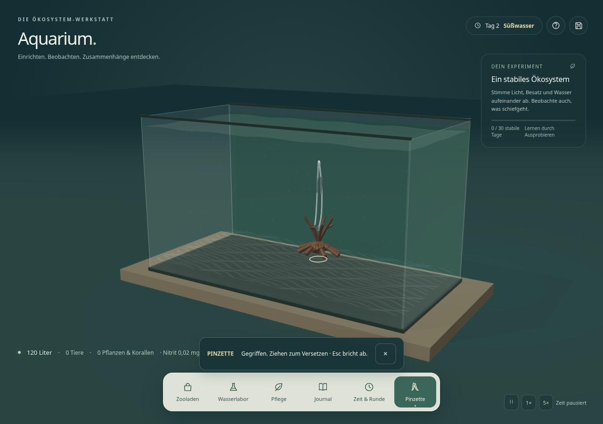

# Simulation-Aquarium

Deutschsprachiges Aquariumsimulationsspiel zum Aufbauen, Beobachten und Erforschen eines vereinfachten Ökosystems. Für Desktop-Browser und Touch-Bedienung entwickelt; statisch auf GitHub Pages unter `/Simulation-Aquarium/` nutzbar. Das Spiel und Teile seiner Inhalte wurden mit KI-Unterstützung erstellt.

## Lernumgebungen für Klassen 8–10

Beim Start **Klasse 8**, **9** oder **10** wählen. Danach stehen **Lernmissionen** (14) und **Freies Forschen** bereit. Jede Mission öffnet automatisch ein kleines, einklappbares **Questbuch**: Anschauen → Vermuten → Ausprobieren → Vergleichen → Erklären. Es erkennt tatsächliche Handlungen und berechnete Ergebnisse. Falsche Antworten lassen sich erneut versuchen. Keine Pflichtzeichnungen oder langen Texteingaben.

**Beobachten** zeigt wenige Wasserwerte bzw. Fischfarben. **Ausprobieren** berechnet zwei gleiche Ausgangsbecken mit einer veränderten Bedingung. **Meine Ergebnisse** sammelt Questantworten und Messungen; **Für die Lehrkraft speichern** erhält auch die vollständigen wissenschaftlichen Daten. Freies Forschen hat keine Pflichtfolge; die Forschungshilfe und eigenen Notizen sind freiwillig. **Mehr** öffnet Wörterhilfe, Darstellung, Pinzette und den Weg zurück zum Start. Grafik und biologische Regeln bleiben unabhängig.

Der **Lehrkraftmodus** bietet Vorbereitung, gezielte Freigaben, vollständige technische Untersuchungen, JSON/CSV/SVG, Seeds, Quellen, Modellgrenzen und lesbare Eltern-/Nachkommenarchive. Er kann auch die normale Schüleransicht starten. Der **Expertenmodus** erhält Freispiel, Tutorial, Szenarien, den vollständigen Katalog und alte Spielstände (`?expert=1`). Alles funktioniert lokal ohne zusätzliches Konto oder bezahlten Dienst. Frühere Lernnotizen und Einstellungen bleiben beim Wechsel zum Questbuch erhalten.

[Neue Oberfläche und Datenübergang](docs/learning/quest/DESIGN.md), [alle 14 Questfolgen](docs/learning/quest/MISSIONS.md), [aktueller Prüfbericht](docs/learning/quest/VALIDATION.md). Die [Fachprüfung](docs/learning/AUDIT.md), der [frühere Masterbericht](docs/learning/REPORT.md) und die [Abnahme R1–R8](docs/learning/ACCEPTANCE.md) dokumentieren den erhaltenen fachlichen Unterbau. Die Zuordnung zum Originalcurriculum ist geprüft; Unterrichtserprobung und physische Safari-iPads bleiben gesonderte Aufgaben.

## Desktop- und iPad-Darstellung

Im Expertenmodus zuerst **Desktop-Version** oder **iPad-Version** wählen, danach Freies Spiel, Tutorial oder Szenarien starten. In den Lernumgebungen ist die Darstellung separat erreichbar. Desktop beginnt mit **Maximum**. Unter **Zeit & Runde → Darstellung** sind später **Hoch**, **Ultra**, **Maximum** und **iPad** wählbar. Der Wechsel baut nur die Grafik neu auf; die biologische Simulation und gespeicherte Becken bleiben gleich. Die Darstellungsauswahl steht getrennt unter `aquarium-graphics-v1` in `localStorage`.

Maximum verwendet die native Pixeldichte, feinere Geometrie, bis zu 4096-Pixel-Oberflächentexturen, bis zu 8192-Pixel-Schatten und die aufwendigere Wasseroptik. Es gibt keine künstliche FPS-Obergrenze. Tatsächliche Hardwaregrenzen und ein Ressourcenbudget verhindern unkontrollierte Grafikallokationen. iPad verwendet dieselben Arten und Funktionen mit geringerer Geometrie-/Texturauflösung, mobilen Dekorations-LODs und einfacheren transparenten Materialien.

Der Grafikdurchgang berücksichtigt **alle 181 Katalogeinträge**, ersetzt alle **11 Dekorationen** durch eigene Blender-GLBs und verfeinert die gemeinsamen Tier-, Pflanzen-, Technik- und Materialpfade. Fünf vorhandene fototexturierte Volumenmodelle und das BlueMesh-Betta-Modell bleiben erhalten. **Die gewünschte umfassende Fotorealistik ist noch nicht erreicht.** Besonders native Tiere, Pflanzen, Wirbellose und Korallen brauchen weitere anatomische und künstlerische Arbeit; mehr Polygone allein genügen nicht.

Die [vollständige Bearbeitungsmatrix](docs/realism/CATALOG_STATUS.md) unterscheidet tatsächliche Änderungen und offenen Modellierungsbedarf. [Grafikarchitektur und Grenzen](docs/realism/README.md), [aktuelle Prüfungen und Live-Screenshots](docs/realism/VALIDATION.md).

## Maßstab und natürliche Körpergrößen

Alle sieben Beckentypen und sämtliche Organismen verwenden dieselbe Zentimeterkalibrierung: **1 Welteinheit entspricht 20 cm**. Art, Geschlecht, Alter, gespeicherter Wachstumsstand und eine kleine stabile Individualvariation bestimmen die Größe. Sie bleibt beim Wechsel von Becken oder Grafikprofil erhalten. Tiere, Pflanzen, Wirbellose und Korallen haben keine manuellen Größen-/Drehregler mehr; Dekorationen behalten diese Einstellungen. Alte Spielstände werden mit protokollierten räumlichen Anpassungen übernommen, ohne Organismen oder Genetik zu löschen.

Eine gezielte Anubias-Überarbeitung ergänzt breite geneigte Blätter und eine dokumentierte CC-BY-Fototextur. Die übrigen Modelle bleiben erhalten. [System, Migration und echte Vorher-/Nachher-Bilder](docs/physical-scale/README.md), [Größen aller Arten und Annahmen](docs/physical-scale/SIZES.md), [Prüfbericht](docs/physical-scale/VALIDATION.md). Vollständiger Fotorealismus und eine neue Netto-Wasservolumenbilanz sind damit noch nicht erreicht.

## Farbvarianten und Genetik

Im Fischshop aktualisiert **Farbe** bei 16 Arten sofort Name und echte 3D-Vorschau. Die gewählte Form bleibt beim einzelnen Tier gespeichert. **Genetik** öffnet echte Elternauswahl, Nachkommen, Abstammung und auf Wunsch Genotypen und Punnett-Quadrate. Molly und Platy dienen ausdrücklich vereinfachten Mendelversuchen; Zebrabärblinge legen zunächst Eier. Wochen- und Zweiwochen-Zeitraffer rechnen dieselbe biologische Simulation einschließlich Wasserwerten und Wachstum weiter.

127 bisher native Organismen erhalten neue eigenständige Blender-GLBs mit Desktop-/Mobilgeometrie. Vier Fischarten verwenden zusätzlich erzeugte Texturvorlagen. Das ist keine pauschale Fotorealismus-Abnahme; die sechs besten Bestandsmodelle bleiben erhalten. [Anleitung und Modellgrenzen](docs/species-genetics/README.md), [aktueller Modellstatus](docs/species-genetics/MODEL_STATUS.md) und [Abschlussbericht](docs/species-genetics/REPORT.md) beschreiben Umfang, Tests und verbleibende Arbeit. Die ältere Grafikmatrix unten dokumentiert den vorherigen Durchgang.

## Phase 1: Aquarium mit der Pinzette gestalten

Nach dem Aufstellen eines Beckens steht unten das Werkzeug **Pinzette** bereit:

1. Pinzette einschalten und ein Tier, eine Pflanze, eine Koralle oder eine Dekoration mit Maus oder Finger greifen.
2. Gedrückt halten und an eine freie Stelle ziehen. Die sichtbare 3D-Pinzette schließt sich, hebt den Gegenstand leicht an und setzt ihn beim Loslassen ab.
3. Beim Absetzen wird die neue Position automatisch im vorhandenen Spielstand gespeichert. Während des Ziehens bleibt die zuletzt gespeicherte Position unverändert.

Die Kamera bleibt im Pinzettenmodus gesperrt. Ein roter Ring kennzeichnet eine blockierte Stelle; beim Loslassen bleibt das Objekt an der letzten freien Stelle. Glasgrenzen, Objektgröße, Drehung, andere Pflanzenbasen, feste Dekorationen und die sichtbare Innenfilter-/Heizertechnik werden berücksichtigt. Schwimmpflanzen bleiben an der Oberfläche. Korallen werden auf dem Boden ausgerichtet. Bei Tieren verschiebt die Pinzette den Schwimmbereich; Schwimmhöhe und eigenständige Bewegung bleiben erhalten. Alle manuell veränderten Positionen werden ausschließlich mit der Pinzette gesetzt; die bisherigen X-/Z-Schieberegler und die alternative Klickplatzierung entfallen. Drehung und Darstellungsgröße bleiben ausschließlich für reine Dekorationen einstellbar.

**Abbrechen:** Esc beendet den Modus und stellt bei einer laufenden Geste die Ausgangsposition wieder her. Eine unterbrochene Touch-Geste, Fokusverlust oder ein Wechsel des Spielstands bricht ebenfalls ab. Auf Touch-Geräten beendet das Kreuz im Hinweis den Modus. Nach Auswahl eines Objekts über seine Detailkarte erlaubt „Mit Pinzette greifen & verschieben“ auch Pfeiltasten; Umschalt vergrößert die Schrittweite.

Neue Dekorationen:

| Gegenstand | Wasser | Gestaltung und mögliche ökologische Funktion |
| --- | --- | --- |
| Verzweigte Fingerwurzel | Süßwasser | Fein verzweigte Äste, Deckung und Biofilmflächen |
| Knorrige Savannenwurzel | Süßwasser | Kompakte Wurzel mit Vertiefungen und Schatten |
| Geschichtete Schieferterrasse | Beide | Versetzte Platten, Spalten und Aufsitzflächen |
| Zerklüfteter Drachenstein | Süßwasser | Ockerfarbene Grate und ausgewaschene Mulden |
| Dunkler Basaltbogen | Beide | Dunkler Fels mit offenem Durchgang und Sichtschutz |
| Poröse Riffhöhle | Meerwasser | Helle, offen durchgängige Höhle mit Aufsitzflächen |

Die neuen Gegenstände suchen beim Kauf eine freie Fläche. Wenn kein Platz vorhanden ist, wird kein weiteres Objekt gestapelt. Wasserarten sind im Shop filterbar; unpassende neue Dekoration wird beim Kauf mit einem Hinweis abgewiesen. Alle bisherigen Katalogeinträge bleiben erhalten.

Die Dekorationen verwenden jetzt eigene, lokal mit Blender erzeugte GLBs in zwei Detailstufen; Oberflächentexturen entstehen lokal aus eigenem Code. Es gibt keine zusätzlichen Konten oder Dienste. Die Modelle sind **noch nicht fotorealistisch**. Die genannten ökologischen Funktionen beschreiben mögliche reale Funktionen; neue Versteck-, Huminstoff- oder Biofilmwerte werden in Phase 1 nicht als zusätzliche Simulationsboni vorgetäuscht. Herkunft und technische Grenzen: [Aquascaping-Dokumentation](docs/AQUASCAPING.md), [GLB-Lizenz](assets/realism/ATTRIBUTION.md).



## Lokal starten

Das Spiel benötigt keinen Build und keine Laufzeitpakete. `index.html`, sämtliche lokalen `.mjs`-/`.css`-Dateien sowie `assets/catalog`, `assets/realism` und `assets/species` gemeinsam bereitstellen. Relative Pfade unterstützen den Projektpfad `/Simulation-Aquarium/`. Die bestehenden Pages- und PR-Vorschau-Workflows bleiben erhalten.

Aus dem Repository-Verzeichnis kann Python den übergeordneten Ordner lokal bereitstellen:

```bash
python3 -m http.server 8000 --bind 127.0.0.1 --directory ..
```

Das Spiel liegt dann auf diesem Server unter `/Simulation-Aquarium/`. Die Cloud-Umgebung enthält die benötigten Entwicklungswerkzeuge bereits. Unter **Zeit & Runde → Komplettes HTML-Spiel herunterladen** wird weiterhin eine eigenständig nutzbare HTML-Datei einschließlich der neuen Funktionen erstellt. Spielstände zusätzlich als JSON exportieren; sie gehören nicht automatisch zum HTML-Download.

Das Speicherformat bleibt Version 1 mit dem bisherigen `localStorage`-Schlüssel `aquarium-werkstatt-v1`. Alte Spielstände werden weiterhin geladen. Die vorhandenen X-/Z-Positionen bleiben relative Beckenkoordinaten; die versionierte `spatial`-Migration prüft Grenzen und feste Nachbarn und archiviert alte biologische Größen-/Drehwerte. Das optionale Feld `aquascapePlaced` kennzeichnet eine per Pinzette gespeicherte Platzierung. Nur feste Objekte werden auf dem Boden verankert; Tiere schwimmen weiterhin selbstständig. Ein einmal gespeicherter Stand mit neuen Dekorationsarten benötigt diese oder eine neuere Spielversion.

## Tests

```bash
node --test tests/*.test.mjs
python3 tests/quest_browser.py
python3 tests/learning_review_browser.py
python3 tests/learning_additional_browser.py
python3 tests/learning_browser.py
python3 tests/readiness_browser.py
python3 tests/species_assets_test.py
python3 tests/physical_scale_browser.py
python3 tests/physical_hardware_browser.py
python3 tests/catalog_ui_browser.py
python3 tests/aquascaping_browser.py
python3 tests/standalone_browser.py
```

Bei Pull Requests führt `module-tests.yml` die kostenlosen Node-Modultests automatisch aus; Pages-Checks prüfen weiterhin die Veröffentlichung. CSV-Schema 2 beschreibt Messnamen, Einheiten, Typen, Seeds und Status: [Datenformat](docs/learning/CSV_SCHEMA.md).

Die Browserprüfungen benötigen Python-Playwright und Chromium und verwenden isolierte Browserprofile. Maßstab-, Katalog-, Aquascaping- und Standalone-Tests starten ihren eigenen vorübergehenden Server. Technik- und Genetiktests erwarten den eingerichteten lokalen Entwicklungsserver; `AQUARIUM_TEST_URL` erlaubt einen anderen Projektpfad. Lern-, Review-, Fokus-, Bereitschafts- und Ökosystemprüfungen verwenden `AQUARIUM_URL`; bei den beiden Expertenprüfungen Bereitschaft/Ökosystem den Zusatz `?expert=1` angeben. Beispiel für den oben beschriebenen Standardserver: `AQUARIUM_URL=http://127.0.0.1:8000/Simulation-Aquarium/ python3 tests/learning_review_browser.py`. GPU-Browserläufe auf dieser CPU-Cloud nacheinander ausführen. In dieser Cloud-Umgebung sind beide vorhanden. Auf anderen Entwicklungsrechnern lässt sich ein installierter Browser über `AQUARIUM_CHROMIUM` auswählen. Optional kann Playwrights eigener Chromium verwendet werden. Es sind keine zusätzlichen Konten nötig.

Getestet werden unter anderem echte Maus-/Touch-Gesten, Kamerasperre, Kollisionen, Glasgrenzen, Abbrechen, Tastaturbedienung, alle sechs neuen Modelle, alte Spielstände und der HTML-Download. Ergebnisse und Screenshots des Aquascaping-Tests liegen standardmäßig unter `/tmp/aquarium-phase1-results`; `AQUARIUM_TEST_RESULTS` ändert das Zielverzeichnis. Tablet-Emulation in Chromium ersetzt keinen Test auf einem echten Safari-iPad. Die vorhandenen Spielstart-/Tutorialprüfungen bleiben zusätzlich Teil der Regression.

Die nächsten Phasen sind in der [Roadmap](docs/ROADMAP.md) beschrieben. Änderungen werden über einen eigenen Branch und Pull Request geprüft; eine Veröffentlichung erfolgt nach manueller Freigabe.

## Katalog, Analyse und Szenarien

Der Featurestand ergänzt 181 lokale, mit Quellen belegte **Modellvorschauen**, den gemeinsamen Analysemodus **Ökosystem** und fünf Szenarien. Die Szenarien starten auf der Startseite und speichern separat vom freien Aquarium. Über den Auftragsknopf sind Hinweise und eigene Untersuchungsnotizen erreichbar. Im Analysemodus stehen Nahrungsnetz, begründete Fragezeichen, Artenprüfung, virtuelles Mikroskop, Stoffumwandlungen, Energiefluss und Umweltwerte zur Verfügung; dabei pausiert die Spielzeit.

Zersetzung, Mineralisierung und sauerstoffbegrenzte Nitrifikation sind jetzt getrennt gekoppelt; tatsächliche Nahrung beeinflusst die Tiergesundheit. Die laufende 3D-Szene ergänzt gemeinsame Schwarmbahnen und eine vom Beckenstand abhängige Wasseroberfläche. Die biologischen und grafischen Modelle bleiben vereinfacht. Eine vollständige Massen-/Energiebilanz oder erreichte Fotorealistik wird nicht behauptet.

Details: [Bedienung, Speicherplätze und Modellgrenzen](docs/ECOSYSTEM.md), [Bildquellen und Erzeugung](docs/CATALOG.md). Zum Bereitstellen alle `.mjs`-/`.css`-Dateien und die drei Assetverzeichnisse mitnehmen; weiterhin kein npm-Build und keine externen Laufzeitdienste. Der HTML-Download bündelt diese Dateien einschließlich Bilder und GLBs.

Zusätzliche Prüfungen in der eingerichteten Cloud-Umgebung:

```bash
node --test tests/*.test.mjs
python3 /workspace/aquarium-devtools/start.py
python3 tests/ecosystem_browser.py
```

Der letzte Befehl verwendet den lokalen Cloud-Server, isolierte Browserprofile und ausschließlich generierte Testspielstände. Ein anderer lokaler Projektpfad ist über `AQUARIUM_URL` konfigurierbar. Ergebnisse liegen unter `/tmp/aquarium-ecosystem-results`.

## Fortsetzung: Detailbilder und realistische Modelle

Artkarten und ausgewählte Beckenobjekte verwenden dieselben artspezifischen Bilder wie der Katalog. Die Fotorealismusprüfung und ihre technischen Grenzen stehen in [UI- und Modellprüfung](docs/UI_MODEL_REVIEW.md). Drei fotobasierte TripoSR-Piloten wurden ohne zusätzliche Konten auf kostenlosen CPU-Standardrunnern erzeugt und tatsächlich im Spiel aus mehreren Blickwinkeln verglichen. Auch der gezielt korrigierte Pflanzenversuch erreicht keine ausreichende anatomische Qualität; deshalb bleibt der bisherige Modellbestand erhalten und es gibt keine Ausweitung auf weitere Arten. [Vergleichsbilder, Quellen und Qualitätsentscheidung](docs/ui-model-review/README.md). Neue vereinfachte Massenmodelle sind nicht Teil dieses Durchgangs.
