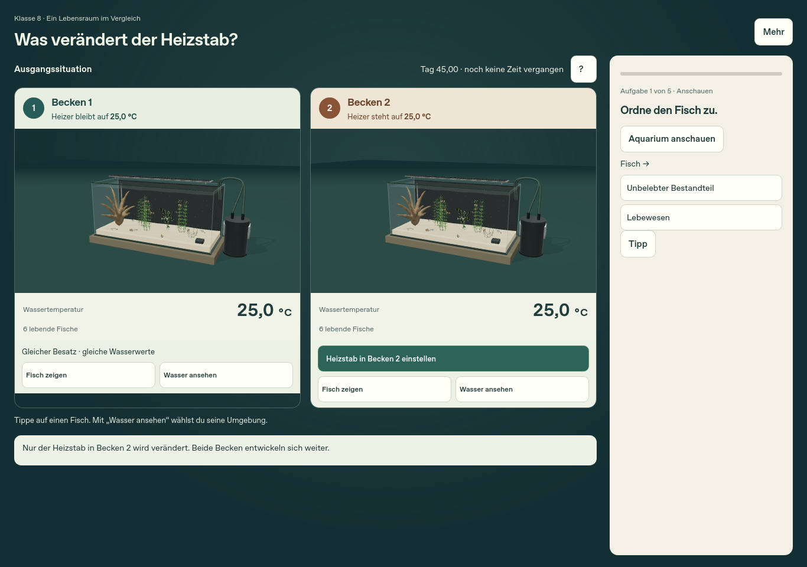
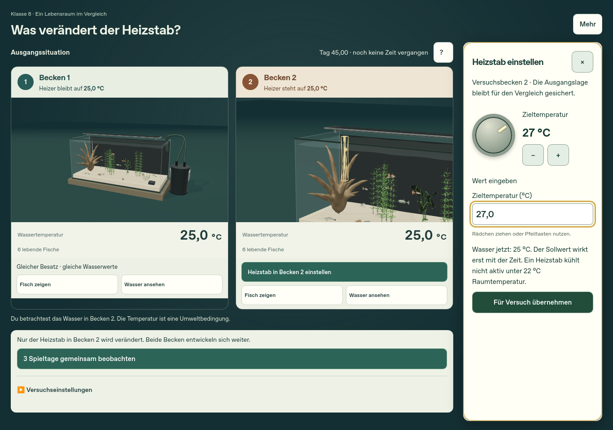
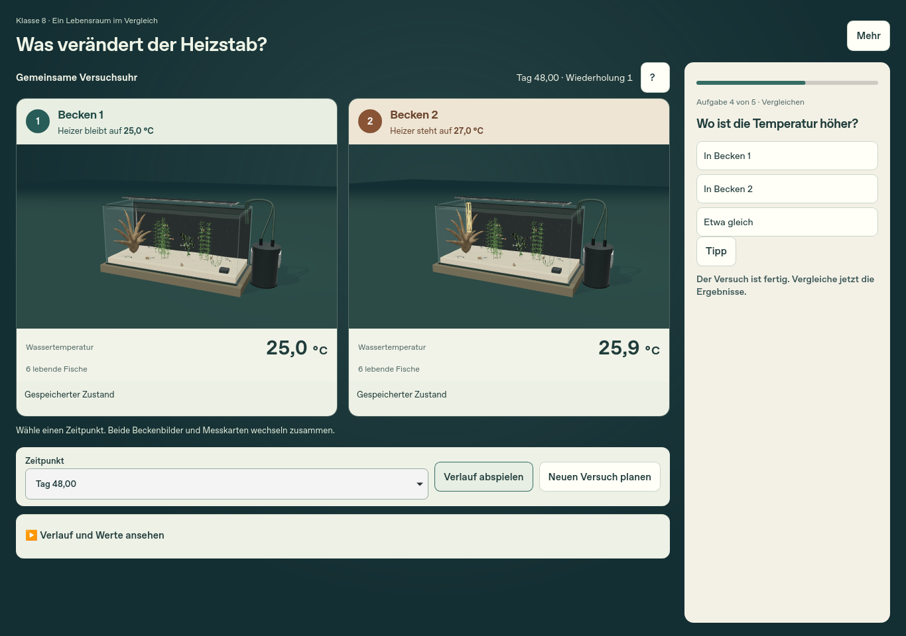
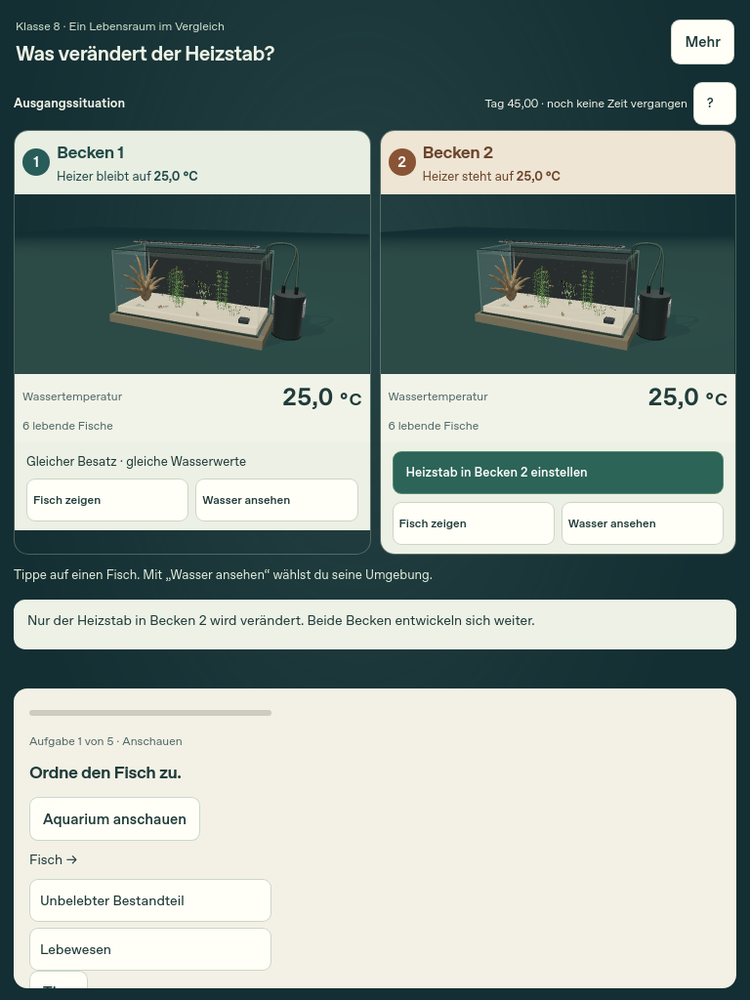

# Temperaturvergleich zur Sichtabnahme

[PR #9](https://github.com/Feerson1617/Simulation-Aquarium/pull/9) · [Spielvorschau](https://feerson1617.github.io/Simulation-Aquarium/pr-preview/pr-9/) · [Prüfbericht und Grenzen](VALIDATION.md)

In der Vorschau **Klasse 8 → Lernmissionen → Ein Aquarium ist ein Ökosystem** öffnen. Eine bereits benutzte Vorschau speichert ihren eigenen Stand; „Noch einmal“ sichert den alten Durchgang vor einem neuen Versuch.

1. Beide beschrifteten Becken vor der Vermutung ansehen. Beide Wasseranzeigen beginnen bei 25,0 °C. „Fisch zeigen“ fokussiert ein tatsächliches Tier; die andere Seite bleibt sichtbar. Fisch und Wasser zuordnen.
2. Nach der Vermutung nur den Heizstab in Becken 2 auf 27 °C stellen und übernehmen. Beide Wasseranzeigen bleiben zunächst bei 25,0 °C. Das Einstellen ändert den Sollwert, noch nicht das Wasser.
3. „3 Spieltage gemeinsam beobachten“ starten. Einen frühen Zeitpunkt wählen oder den Verlauf abspielen. Beide Beckenbilder, Messkarten, Tabelle und Diagrammzeiger beziehen sich auf dieselbe Zeit.
4. Am Ende hat Becken 2 in diesem Lauf etwa 25,9 °C. Den Unterschied zwischen Heizsollwert und gemessenem Wasserwert anhand beider Seiten erklären. Unter „Verlauf und Werte ansehen“ sind Wiederholung, Reihe und Zeitpunkt wählbar.
5. Unter „Mehr → Meine Ergebnisse“ speichern; neu laden und fortsetzen. „Neuen Versuch planen“ zeigt wieder die vorbereiteten Becken und kennzeichnet frühere Daten getrennt. Ein neuer Durchgang archiviert den bisherigen Abschluss.

## Tatsächliche Browserbilder

Die folgenden Bilder stammen aus dem abschließenden Linux-WebKit-Lauf am geprüften Anwendungscode; kein nachgebautes Design und keine physische iPad-Aufnahme.

Desktop, vor der Vermutung:

Heizstabfokus, während beide aktuellen Wasserwerte sichtbar bleiben:

Ergebnis mit gemeinsamem Zeitpunkt und tatsächlichen Wassertemperaturen:

Tablet-Hochformat, derselbe Startvergleich:

Die Modellausstattung ist erhalten, aber nicht als abgeschlossener Fotorealismus bewertet. Echte Schul-iPads/Safari und die Verständlichkeit im Unterricht müssen noch geprüft werden. Der Masterauftrag verlangt hier ausdrücklich die **Sichtfreigabe durch den Auftraggeber**, bevor die übrigen Missionen neu gestaltet werden.
