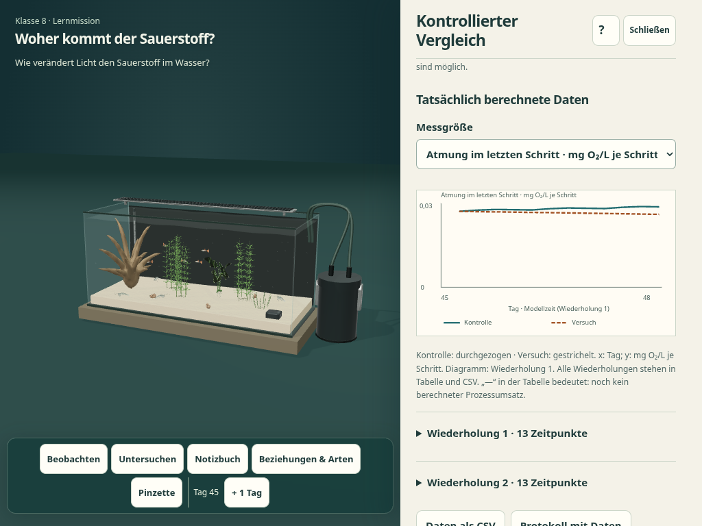
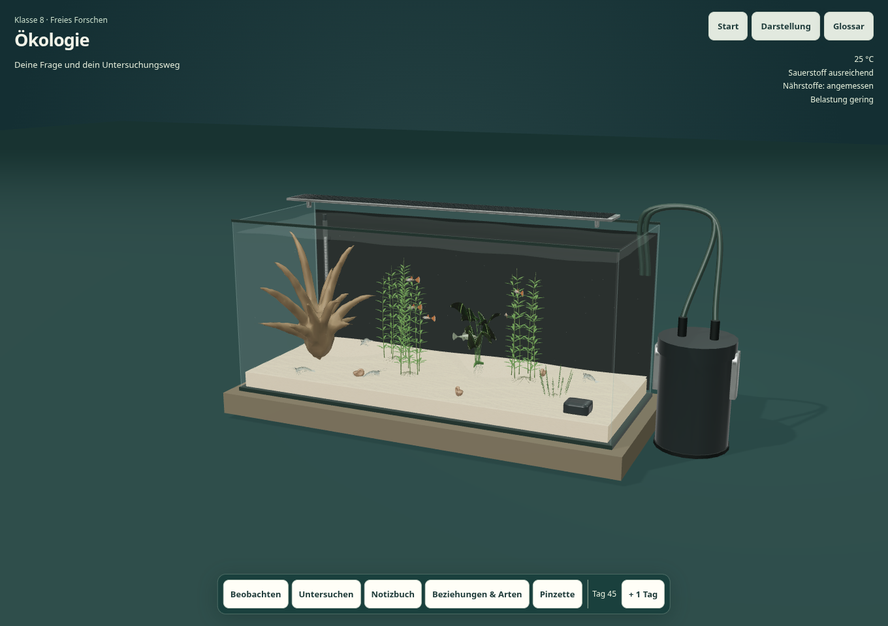
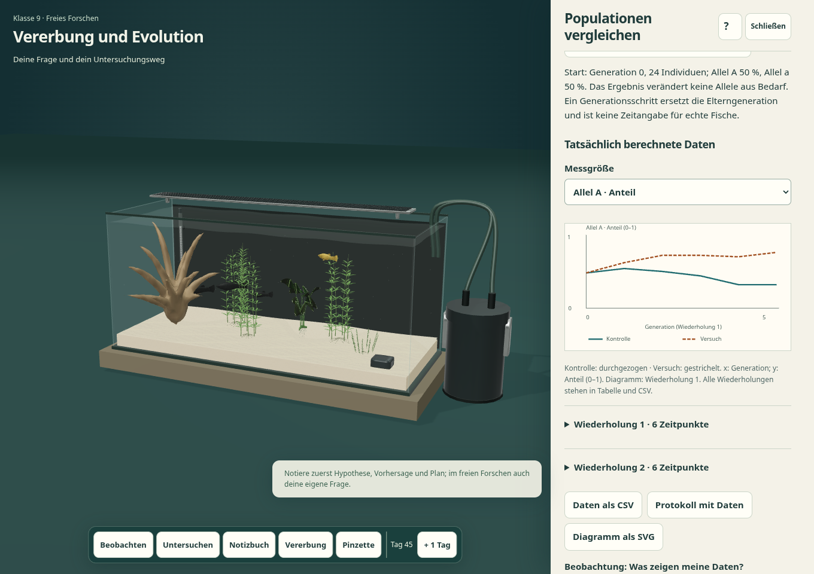
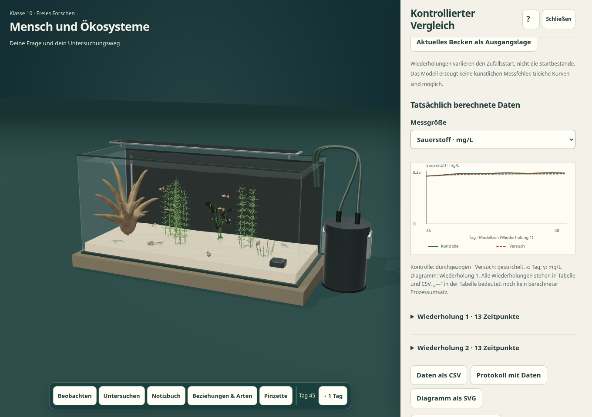

# Fachliche und technische Prüfung der Lernumgebungen

Geprüfter Laufzeitstand: `9e13bbb`. Prüfumgebung: Node 24, Python 3.12, Playwright/Chromium 154, CPU-Softwaregrafik (SwiftShader); statischer Server unter einem Projekt-Unterpfad. Keine kostenpflichtigen Werkzeuge, Konten oder externen Laufzeitdienste.

## Abgeschlossene Prüfungen

| Prüfung | Ergebnis / Nachweis |
|---|---|
| Rechenkern und reine Module | **87 erfolgreich**, 0 Fehler, 0 übersprungen; [Protokoll](evidence/node-tests.log) |
| Gezielte wissenschaftliche und Bedienprüfungen im echten Browser | **6 erfolgreich**, keine JavaScript-Ausnahme; [Bericht](evidence/focused-report.json) |
| Lernprofile, alle 14 Missionen, Lehrkraft und Touch | **19 verschiedene Prüfpunkte erfolgreich**, in zwei Abschnitten; [zusammengeführter Nachweis](evidence/learning-combined-report.json) |
| Bisheriger Spielstart, Katalog, Speichern/Laden und vollständiges Touch-Tutorial | **13 erfolgreich**; [Bericht](evidence/readiness-report.json) |
| Pinzette, Platzierung, Kollisionen, Dekorationen, Maus/Touch/Tastatur | **12 erfolgreich**; [Bericht](evidence/aquascaping-report.json) |
| Bisherige Ökosystemanalyse und alle fünf Szenarien | **12 erfolgreich**; [Bericht](evidence/ecosystem-report.json) |
| Bestehende Genetik, reale F1/F2, Platy, Eier und Jungfische | **9 erfolgreich**; [Bericht](evidence/genetics-report.json) |
| Eigenständiger HTML-Gesamtdownload | **erfolgreich**, 151.023.814 Bytes; [Protokoll](evidence/standalone.log) |

Damit sind **87 Modultests und 71 Browserprüfpunkte** sowie die Einzeldatei-Prüfung abgeschlossen. [Maschinenlesbare Übersicht](evidence/verification.json). Die Browsergruppen wurden wegen der Softwaregrafik nacheinander ausgeführt. Die sieben bearbeiteten Laufzeitdateien blieben während der Endprüfung unverändert; die [Prüfsummen](evidence/runtime.sha256) wurden bei der Übernahme der Ergebnisse erneut abgeglichen.

Die Lernprüfung wurde ohne Wiederholung bereits bestandener Missionen abgeschlossen: Der [erste Abschnitt](evidence/learning-missions-report.json) bestand 14 Prüfpunkte einschließlich aller freien Forschungspfade und aller Missionen. Anschließend versuchte das Prüfskript, eine Option in einem noch eingeklappten Lehrkraftbereich anzuklicken. Dieses ursprüngliche Protokoll bleibt mit seinem Status `failed` erhalten. Nach Korrektur des Skripts wurde ausschließlich der noch offene [Lehrkraft-/Touch-Abschnitt](evidence/learning-report.json) fortgesetzt. Beide Abschnitte ergeben nach Abzug des gemeinsamen Startprüfpunkts 19 verschiedene erfolgreiche Prüfungen. Es war keine Änderung am Spielcode erforderlich.

Frühere unvollständige Läufe werden nicht zusätzlich als Erfolge gezählt. Ein Prozess verlor die Ausgabeverbindung (`Broken pipe`); die Endprüfung lief deshalb unabhängig vom Chat mit dauerhaften Statusdateien. Importprüfungen warten auf das tatsächliche Ende der asynchronen Dateilesung. In den abschließenden Browsergruppen gab es keine JavaScript-Ausnahmen, Shaderfehler oder fehlenden Spielressourcen. Einige bestehende Prüfer protokollieren einen harmlosen 404-Abruf für das nicht vorhandene `/favicon.ico`; dieser ist in den Rohberichten sichtbar.

Der heruntergeladene HTML-Stand wurde allein über einen lokalen HTTP-Server geöffnet: Szene, Dekoration, Farbvarianten, Genetik, Pinzette, Curriculumtransfer und der echte Vergleichsrechenkern funktionieren ohne weitere HTTP-Ressourcen. Eine direkte `file:`-Navigation wurde vom verwalteten Chromium blockiert und ist daher **nicht** als bestanden ausgewiesen.

## Was tatsächlich geprüft ist

- 14 didaktische Missionsprofile mit fachlicher Klärung, Vorvorstellung, Untersuchungsweg, Sicherung und Modellgrenzen; Jahrgangszuordnung aus dem Original-PDF.
- Getrennte Warnpfade im Belastungsindikator; ein kritischer Einzelwert wird nicht herausgemittelt. Gleichzeitiger Nährstoffüberschuss und -mangel sind möglich.
- Tatsächlich gezogene F1-/F2-Keimzellen, Elternarchive und gezählte Allele. Neutrale Kontrollen stimmen bei gleichen Seeds überein; Umkehr der hypothetischen Umwelt kehrt den Selektionsvorteil um. Verlorene Allele entstehen nicht aus Bedarf neu.
- Pflanzenwachstum stoppt im tatsächlichen gemeinsamen Rechenkern bei erschöpften Ressourcen, während Atmung weiterläuft. Algenaufnahme ist ressourcen-/kapazitätsbegrenzt; organischer Rückfluss wird berechnet.
- Ein noch nicht berechneter Anfangsumsatz bleibt `null`/„—“, kein erfundener Nullmesswert. Diagramm, Tabelle, CSV, JSON und validierter Lehrkraftimport erhalten diese Unterscheidung.
- Kontext-? per Tastatur, Fokus innerhalb der Hilfe und korrekte Rückkehr. Das Becken bleibt bei offenem Werkzeug für Eingaben gesperrt.
- Pinzettenanzeige folgt Esc; leere numerische Eingaben werden abgewiesen. Die verdeckte Startansicht hält Rendererframes konstant und lässt sie beim Wiederöffnen weiterlaufen.
- Bei gesperrtem Browserspeicher erscheint ein sichtbarer Hinweis; das im Arbeitsspeicher vorhandene Lernprodukt lässt sich weiterhin als Datei exportieren.

[Exportiertes eigenständig beschriftetes SVG](evidence/process-flux.svg). Der Anfangswert des Prozessumsatzes wird nicht gezeichnet, weil noch kein Rechenschritt vorliegt.

## Tatsächliche Ansichten

Die folgenden Aufnahmen stammen aus den bestandenen Prüfabschnitten, nicht aus Entwürfen. Desktop: 1360 × 960; Tablet-Hochformat: 768 × 1024 mit emulierter Touch-Eingabe.

Die Texte und Schaltflächen der drei Tabletansichten wurden zusätzlich visuell geprüft: [Klasse 8 mit auftragsbezogener O₂-Messung](evidence/ipad-grade-8-observe.png), [Klasse 9 mit Vererbung statt Chemietabelle](evidence/ipad-grade-9-genetics.png), [Klasse 10 mit Wattenmeer-Transfer](evidence/ipad-grade-10-transfer.png). Es gibt keinen horizontalen Seitenüberlauf; längere Inhalte sind im Werkzeug scrollbar. Im Hochformat bleibt das Becken bei offenem Seitenwerkzeug sichtbar, wird aber deutlich kleiner. Für genaue Beobachtungen das Werkzeug schließen oder ins Querformat wechseln; die Lesbarkeit auf physischen Schulgeräten muss noch erprobt werden.

Weitere Belege: [Lehrkraftvorbereitung](evidence/teacher-preparation.png), [tatsächlich erzeugte F2](evidence/grade-9-f2.png), [Wattenmeerauftrag am Desktop](evidence/grade-10-wadden-transfer.png), [Klasse-8-Vergleich](evidence/grade-8-comparison.png), [Jahrgangsauswahl](evidence/01-grade-start.png).

## Grenzen der Abnahme

Die Browserprüfungen sind technische Integration und begründete Oberflächenprüfung, kein empirischer Wirksamkeitsnachweis. Eine echte Unterrichtserprobung sowie physische Schul-iPads/Safari wurden hier nicht durchgeführt. Aus Softwaregrafik werden keine Hardware-FPS oder Akkulaufzeiten abgeleitet.

Der wissenschaftliche Abgleich, die Modellannahmen und alle Indikatorschwellen stehen im [Audit](AUDIT.md). Die curriculare Zuordnung und offenen Modellgrenzen stehen im [Bericht](REPORT.md). Wald, Nordsee und Wattenmeer werden ausdrücklich als begrenzter Transfer behandelt; die Simulation berechnet keine Gezeiten, Plastiktoxikologie oder geschlossene Kohlenstoffbilanz.

Die [Prüfsummen](evidence/runtime.sha256) beziehen sich auf die bearbeiteten Laufzeitdateien. Die vorhandenen hochwertigen GLBs, Texturen, `AGENTS.md` und Veröffentlichungsworkflows wurden nicht geändert.
