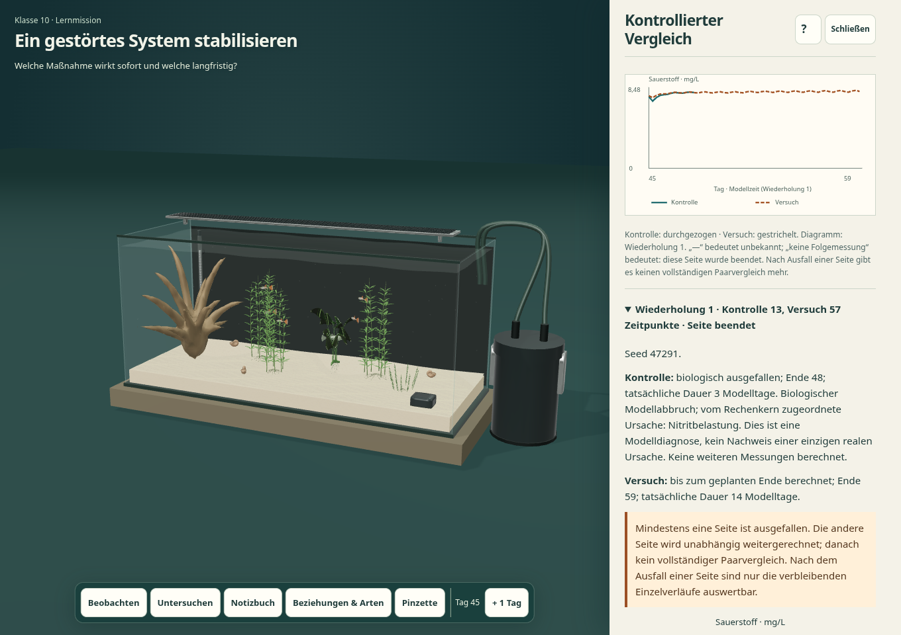
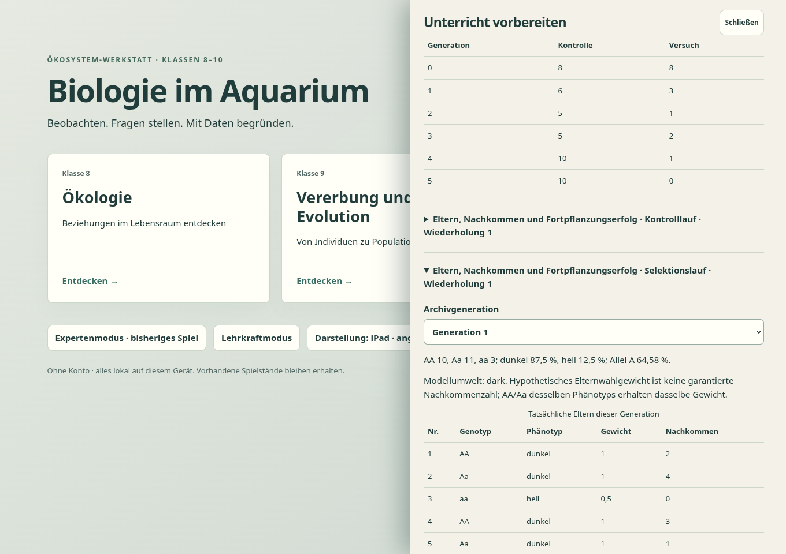
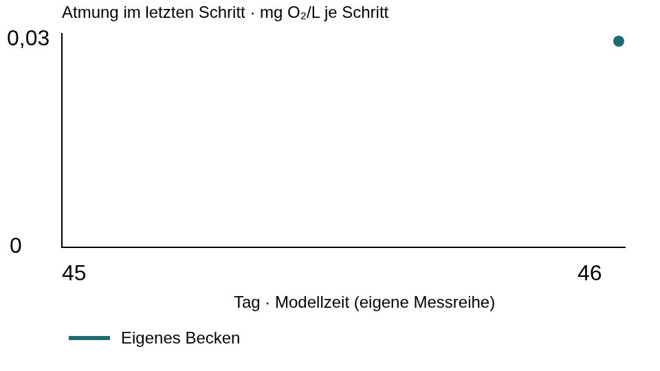

# Fachliche und technische Prüfung nach PR-8-Review

Stand: 21.10.2026. Geprüfter eingefrorener Laufzeitstand: **`7e82046`**. Alle neun seriellen Prüfgruppen wurden abgeschlossen. Die sieben bearbeiteten Laufzeitdateien blieben dabei unverändert; [Prüfsummen](evidence/revision-2/runtime.sha256), [Runnerstatus](evidence/revision-2/runner-status.json), [maschinenlesbare Zuordnung](evidence/revision-2/verification.json).

Werkzeuge: Node 24.19.0, Python 3.12.14, Playwright 1.62.0, Chromium 154.0.8037.57 mit SwiftShader. Statischer Server unter einem Projektunterpfad; isolierte Browserprofile. Keine zusätzlichen Konten, kostenpflichtigen Werkzeuge oder externen Laufzeitdienste. Softwaregrafik ist keine Hardware-Leistungsmessung.

## Abschließende Ergebnisse

| Gruppe | Ergebnis | Rohbeleg |
|---|---|---|
| Vorhandene 87 und 13 neue Modultests | **100 bestanden**, keine Fehler oder übersprungenen Tests | [Node-Protokoll](evidence/revision-2/unit.log) |
| Gezielte R1–R8-Verhaltenstests im Browser | **11 Prüfpunkte bestanden** | [Bericht](evidence/revision-2/review-report.json) |
| Drei Lernprofile, freie Forschung, alle 14 Missionen, Lehrkraft und Touch | **19 Prüfpunkte bestanden** | [Bericht](evidence/revision-2/learning-report.json) |
| Zusätzliche Fach-/Fokus-/Speicherprüfungen | **6 bestanden** | [Bericht](evidence/revision-2/focused-report.json) |
| Expertenstart, Platzierung, Katalog, Speichern/Laden und alle acht Touch-Tutorialschritte | **13 bestanden** | [Bericht](evidence/revision-2/readiness-report.json) |
| Pinzette, Dekoration, Kollisionen, Maus/Touch/Tastatur | **12 bestanden** | [Bericht](evidence/revision-2/aquascaping-report.json) |
| Ökosystemanalyse und alle fünf bisherigen Szenarien | **12 bestanden** | [Bericht](evidence/revision-2/ecosystem-report.json) |
| Bisherige reale Genetik, F1/F2, Platy, Eier und Jungfische | **9 bestanden** | [Bericht](evidence/revision-2/genetics-report.json) |
| Eigenständiger HTML-Gesamtdownload | **bestanden**, 151.070.285 Bytes | [Protokoll](evidence/revision-2/standalone.log) |

Damit sind **100 Modultests und 82 Browserprüfpunkte** sowie die zusätzliche Einzeldatei-Prüfung abgeschlossen. Gruppen-/Sammelprüfpunkte werden nicht nachträglich als einzelne Unterrichtsversuche gezählt. Der Missionsprüfer öffnet jede der 14 Missionen und rechnet einen echten Tag; das ist keine vollständige Unterrichtserprobung aller möglichen Untersuchungswege.

## Was die R1–R8-Prüfungen tatsächlich nachweisen

- **R1:** Echter Sanierungsfall, 50 % einmaliger Wasserwechsel, 14 Tage: Kontrolle fällt an Tag 48 nach 13 Messpunkten aus; Versuch bleibt lauffähig und erreicht Tag 59 mit 57 Messpunkten. Die unabhängig aus dem tatsächlich veränderten Becken weitergerechnete Kernprobe stimmt numerisch mit dem Versuch überein. Der Kern meldet Nitrit als Modelldiagnose. Der zusätzliche 3-Tage-Fall erfasst den Ausfall genau im letzten angeforderten Schritt. Keine künstlich aufgefüllten Arrays; Tabelle/CSV unterscheiden fehlende Folgemessung und echte Null.
- **R2:** Echter Download → validierter Dateiimport → Lehrkraftansicht: Werkzeug/Wert, geplante und tatsächliche Dauer, Status/Ursache, Seed/Umwelt, Modellstand/Annahmen, eingefrorene Planung, eigene Messungen und Genetikbelege bleiben lesbar. Ausgewählte Nitritwerte werden mit den exportierten Zahlen verglichen; lokale Ansicht und Import zeigen dieselbe Laufkonfiguration. Zwei echte Exporte der bisherigen Version 1 sind zusätzlich als Modultestfixtures geprüft. Importierte Enginezustände werden nicht ausgeführt.
- **R3:** Nach dem Wechsel von Ausgangstag 45 auf 46 aktualisiert sich der Plan sofort; Eingriffs-/Planänderungen markieren das ältere Ergebnis. JSON erhält getrennt den aktuellen Plan und die unveränderte tatsächlich berechnete Wasserwechsel-Konfiguration. Auch ein unvollständiger neuer Entwurf lässt die alten Daten im Lehrkraftimport lesbar.
- **R4:** S. 19 des Originalcurriculums erneut textuell und visuell gelesen. Die fertige Schüleransicht enthält fossile Verbrennung, Landnutzung, Speicher/Flüsse, Hintergrundquellen, Aufgaben, Sicherung und Modellkritik. Aquariumdaten und globale Schlussfolgerungen sind getrennt; CO₂-Dosierstufen werden nicht zu globalen Emissionen hochgerechnet. Externe IPCC-Webinhalte wurden hier nicht live abgerufen.
- **R5:** Gleicher dokumentierter Seed und gleiche Elternwahl reproduzieren echte F1/F2. Neuer/gewählter Seed erhält die Gründer und ändert die Keimzellziehungen. AA × aa bleibt Aa; F2 wird nicht auf ein genaues Verhältnis gezwungen. Export und Lehrkraftansicht enthalten die tatsächlichen Eltern-/Kindbelege und Wiederholungsdaten.
- **R6:** Aus jedem gespeicherten Kontroll-/Selektionsarchiv werden Genotypzahlen, Allel-/Phänotypfrequenzen und Nachkommenzahl je Elternteil rekonstruiert und gegen die Zeitreihen geprüft. Neutralität, Umweltumkehr und fehlendes Wiedererscheinen verlorener Allele sind als Module geprüft. Die Browseransicht macht Eltern, Phänotyp, hypothetisches Gewicht und Kinder tatsächlich zugänglich.
- **R7:** Eigene Messungen ohne automatischen Vergleich erscheinen in Tabelle, Diagramm, SVG/CSV/JSON und Lehrkraftansicht. Unbekannter Anfangsumsatz bleibt unbekannt; bei genau einem bekannten Wert wird ein sichtbarer Punkt gezeichnet. Die Browserassertion prüft diesen Punkt auch nach dem Import.
- **R8:** CSV wird tatsächlich heruntergeladen und unabhängig geparst. Namen, Einheiten, Typen, Profil, Eingriff/Wert, Umfang, Seed, Zeit und Status stimmen; unbekannt/fehlend bleibt von 0 unterscheidbar. Textmetadaten werden in Tabellenkalkulationen als Literal geschützt. [Schema und Grenzen](CSV_SCHEMA.md).

## Tatsächliche Ansichten und Datenbelege

Die Einzelpunkt-Abbildung zeigt den im Browser gerenderten tatsächlichen SVG-Export; die [zugehörige Spielansicht mit Datentabelle](evidence/revision-2/r7-own-measurement-series.png) ist separat erhalten.

Weitere Aufnahmen: [R2 Lehrkraft/Nitrit](evidence/revision-2/r2-teacher-nitrite-status.png), [R3 neuer Plan / alter Lauf](evidence/revision-2/r3-plan-changed-old-result.png), [R4 Kohlenstofftransfer am Tablet](evidence/revision-2/r4-tablet-carbon-transfer.png), [R5 Wiederholungswerkzeuge am Tablet](evidence/revision-2/r5-tablet-repetition-controls.png). Die vollständigen Jahrgangsansichten stammen aus dem allgemeinen Lernprüfer: [Klasse 8](evidence/revision-2/ipad-grade-8-observe.png), [Klasse 9](evidence/revision-2/ipad-grade-9-genetics.png), [Klasse 10](evidence/revision-2/ipad-grade-10-transfer.png).

Die Texte, Tabellen und Schaltflächen wurden visuell geprüft. Hochformatansichten haben keinen horizontalen Seitenüberlauf; lange Inhalte sind scrollbar, Archive öffnen einzelne Generationen bedarfsweise. Das Becken wird neben einem offenen Werkzeug deutlich kleiner. Für genaue Beobachtungen Werkzeug schließen oder Querformat nutzen; Lesbarkeit und Bedienbarkeit auf echten Schulgeräten sind noch praktisch zu prüfen.

Echte Exportbelege: [Sanierung/Plan/Notizen](evidence/revision-2/r2-r3-full-learning-product.json), [eigene Messungen](evidence/revision-2/r7-own-observations.json), [Mendelarchiv](evidence/revision-2/r5-mendel-evidence.json), [Selektionsarchive](evidence/revision-2/r6-population-evidence.json), [CSV mit fehlenden Folgemessungen](evidence/revision-2/r1-restoration.csv), [eigene Reihe als SVG](evidence/revision-2/r7-own-observations.svg).

## Abgrenzung und Historie

Vorläuferläufe stoppten an Prüfskriptfehlern (Unterstützungsbeschriftung bzw. Auswahl der Mendelmission für Selektionswerkzeuge). Ein bereits weit fortgeschrittener Lauf auf `a498124` wurde bewusst unterbrochen, um die sichtbare Markierung eines einzelnen bekannten Messwerts zu ergänzen. [Historische Rohprotokolle](evidence/revision-2/intermediate/README.md). Diese Teilergebnisse werden nicht als vollständige Abnahme und nicht zusätzlich gezählt. Maßgeblich ist der anschließend vollständig ausgeführte Stand `7e82046` mit eigenem Prüfsummenverzeichnis. Die alten 87/71-Belege im übergeordneten Evidenzordner bleiben als historischer erster Masterstand erhalten.

Die heruntergeladene Einzeldatei wurde allein über HTTP geöffnet, ohne zusätzliche Modul-/Bild-/GLB-Abrufe. Direkte `file:`-Navigation wurde von der verwalteten Chromium-Richtlinie blockiert und ist nicht als Erfolg ausgewiesen. Einige bestehende Prüfer protokollieren einen harmlosen 404-Abruf für `/favicon.ico`; dies ist von fehlenden Spielressourcen getrennt und in den Rohberichten sichtbar.

Physische Safari-/Schul-iPads, vollständige Hilfstechnikprüfung, Unterrichtserprobung und empirische Lernwirksamkeit sind **offen**. Es gibt keine Hardware-FPS-/Akkulaufzeitaussage aus SwiftShader. Die fachlichen Modellgrenzen stehen im [Audit](AUDIT.md), alle Masteranforderungen/14 Missionen in der [Abnahmematrix](ACCEPTANCE.md). Keine geschlossene Kohlenstoff-/Energiebilanz; Wald, Nordsee und Wattenmeer bleiben begrenzte Transfers.

Der neue PR-Modultestworkflow wurde als YAML und mit seinem tatsächlichen Node-Befehl lokal geprüft. Seine externe GitHub-Ausführung ist wegen des API-Zugriffs nicht bestätigt. Pages-Checks sind keine fachliche Abnahme. Kein Merge und keine Änderung an `main`, `AGENTS.md`, Assets oder den bestehenden Veröffentlichungsworkflows.
