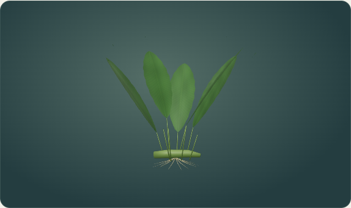
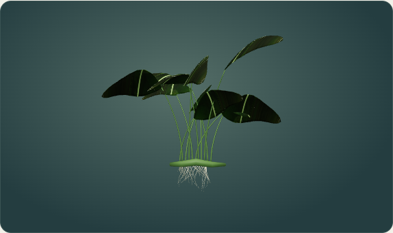

# Physikalischer Maßstab, biologische Größen und Anubias

Die Aquariumsszene verwendet einen gemeinsamen Maßstab: **1 Three.js-Welteinheit = 20 cm**. Die Länge eines Organismus hängt von Art, Geschlecht, Entwicklungsstand und einer kleinen stabilen Individualvariation ab. Die Beckengröße verändert diese Körperlänge nicht. Alle 144 Organismen-/Dekorations-IDs besitzen deklarierte Größenwerte; [Tabelle mit Annahmen und Quellen](SIZES.md), ausführliche Daten in `species-dimensions.mjs`.

## Bedienung

Bei Fischen, Pflanzen, Wirbellosen und Korallen entfallen **Drehung & Größe**, **Drehung** und **Darstellungsgröße** vollständig. Die Detailkarte nennt stattdessen ungefähre Zentimetermaße. Reine Dekorationen behalten ihre Aquascaping-Regler. Wasser, Licht, Simulationstempo, Grafik und biologische Pflege bleiben erhalten. **Pflanze kürzen** verändert die gespeicherte Biomasse und damit den Entwicklungsstand; die Pinzette verändert die Position.

Die bereits in PR #6 eingeführten gemeinsamen Artbilder und die Beschriftung **Farbe** bleiben bestehen. Nahansichten dürfen kleine Arten vergrößern und sind als Artansicht zu verstehen; der Beckenrenderer verwendet den physikalischen Maßstab.

## Becken und Umgebung

| Nennvolumen | Länge × Tiefe × Höhe außen | Bruttorauminhalt | Glasstärke |
| --- | --- | --- | --- |
| 30 L | 40 × 25 × 30 cm | 30 L | 0,4 cm |
| 60 L | 60 × 30 × 35 cm | 63 L | 0,5 cm |
| 120 L | 80 × 40 × 40 cm | 128 L | 0,6 cm |
| 180 L | 100 × 40 × 45 cm | 180 L | 0,6 cm |
| 300 L | 120 × 50 × 50 cm | 300 L | 0,8 cm |
| 450 L | 150 × 50 × 60 cm | 450 L | 1,0 cm |
| 700 L | 200 × 60 × 60 cm | 720 L | 1,2 cm |

Die Außenmaße stammen aus den vorhandenen Beckenbeschreibungen. Glasstärken sind plausible Modellannahmen, keine Bauanleitung oder statische Sicherheitsberechnung. Das bisherige Nennvolumen bleibt für die biologische Simulation erhalten. Bruttovolumen und tatsächlicher Nettoinhalt nach Glas, Wasserstand, Bodengrund und Einrichtung sind nicht identisch; eine neue Netto-Wasservolumenbilanz wurde nicht in die bestehende Chemie eingeführt.

Der Bodengrund besitzt eine Grundschicht von 4 cm mit kleiner Geländeneigung. Technik besitzt gemeinsame Zentimeterdefinitionen für Rendering und Platzierungsabstände. Innenfilter, Heizer, Abschäumer und Belüftungsdiffusor werden innerhalb der Glasscheiben an getrennten Standorten angeordnet. Außenfilter und Leuchte bleiben außerhalb des Wassers; Leuchtenlänge und geeignete Heizerbaugröße berücksichtigen den Beckentyp. Sockel, Kamera, Wasseroberfläche und Glas passen sich den echten Beckenabmessungen an.

## Organismen, Wachstum und LOD

Fisch-/Wirbellosenmodelle werden an ihren tatsächlich geladenen, geschlechtsabhängigen Vertexdaten vermessen; bei Wirbellosen zählt der Körper beziehungsweise die Schale statt langer Antennen. Anatomische Proportionen bleiben dabei erhalten. Die Eltern- und Jungtiermodelle erhalten dieselbe Kalibrierung. Bei Pflanzen und Korallen legen Wuchshöhe und Bestandsbreite die Kalibrierung fest. Die Breite ist der umhüllende Kronendurchmesser aus den realen Vertexabständen zum Modellzentrum; sie bleibt bei Drehungen als Grenze gültig. Die Prüfung trennt Wurzelbasen voneinander. Nachbarblätter dürfen sich natürlich überlagern, während die reife Krone vollständig innerhalb der Glasscheiben bleiben muss. Die Pflanzenbasis bleibt aufrecht; lokale Blattbewegung durch Strömung bleibt erhalten. Unterschiedliche GLB-Ausgangseinheiten erzeugen keine willkürlichen Größen mehr.

Die gespeicherte Individual-ID und Art bestimmen eine reproduzierbare Variation zwischen 94 und 106 Prozent. Sie verbraucht keine Zufallszahlen der biologischen Simulation. Hinterlegte Geschlechtswerte betreffen Guppy, Molly, Platy, Schwertträger, Endler, Metallpanzerwels, Betta, Antennenwels und Schmetterlingsbuntbarsch. Für andere Arten werden keine unbekannten exakten Geschlechtsunterschiede behauptet.

Genetisch erzeugte Jungfische wachsen im bestehenden beschleunigten Modell von 30 Prozent zur Reife nach sieben Spieltagen. Bereits ältere, nicht genetisch dokumentierte Jungtiere verwenden die vorhandene Alterskurve bis 15 Tage. Pflanzen-/Koloniehöhen folgen der gespeicherten Biomasse mit einer begrenzten kubischen Größenkurve; bei Biomasse 2,2 wird die gewählte Referenzhöhe erreicht. Zusätzliche Biomasse wird noch nicht als neue individuelle Zweige gerendert. Wachstum hängt nicht von der Dauer der Anzeigeanimation ab.

Desktop und iPad verwenden dieselben Größenfunktionen. Jede LOD-Geometrie wird neu vermessen und auf dieselbe relevante Körperlänge beziehungsweise Wuchshöhe gebracht. Kleinere Unterschiede in Nebenkonturen einer vereinfachten LOD sind weiterhin möglich; es gibt keinen Sichtbarkeitsbonus für kleine Tiere. Ihre vergrößerte Artgalerie bleibt verfügbar.

## Positionen und Spielstandmigration

Das Hauptspeicherformat bleibt Version 1. **Gespeicherte X-/Z-Werte bleiben relative Beckenkoordinaten**, deren Bedeutung unter `spatial.positions = tank-normalized-v1` ausdrücklich festgelegt ist. Erst die gemeinsame Transformation rechnet sie in die physikalische Welt um. Dadurch behalten alte Becken ihre Anordnung relativ zu ihren Scheiben; niemand muss alte Zahlenwerte als Zentimeter missverstehen.

Beim ersten Import alter Spielstände werden manuelle biologische Größen/Drehungen durch den natürlichen Entwicklungsstand ersetzt. Die bisherigen Werte bleiben unter `spatial.originalOverrides` erhalten. Positionen werden auf passende Grenzen und feste Nachbarn geprüft; nötige Verschiebungen werden mit Ausgangs- und Zielkoordinaten unter `spatial.relocations` aufgezeichnet. Pflanzen reservieren ihren reifen Wurzel-/Rhizombereich, Korallen ihre gewählte Koloniefläche. Blätter dürfen sich natürlich überlagern. Käufe fester Objekte suchen eine passende zusammenhängende Fläche; wird keine gefunden, wird kein Objekt gestapelt. Zufällig gedrehte Stücke können freie Fläche aufteilen. Die Suche räumt vorhandene Einrichtung nicht automatisch um; die Pinzette und Dekorationsausrichtung helfen beim Neuordnen. Ein späterer Becken- oder Technikwechsel prüft die Anordnung erneut. Zuvor nicht platzierbare Objekte werden bei zusätzlichem Platz wieder zugelassen; das Protokoll bleibt pro gespeicherter UID begrenzt. Bei entfernten Individuen werden nicht mehr benötigte Positionsprotokolle verworfen, sodass wiederholte Besatzwechsel die Importgrenze nicht überschreiten.

Ein physisch überfüllter alter Bestand kann keine überschneidungsfreie Lösung haben. Solche Objekte bleiben mit UID, Genetik und biologischem Zustand gespeichert und werden ausdrücklich als vorübergehend nicht dargestellt gemeldet (`spatial.unplaced`), statt gelöscht oder verkleinert zu werden. Über die Detailauswahl, Pinzette oder bewusste Bestandsreduktion kann ein geeigneter Platz hergestellt werden. Zu große Tiere werden ebenfalls nicht künstlich verkleinert. Zu hohe Pflanzen können emers wachsen; die Karte weist auf Kürzen oder ein höheres Becken hin.

Pinzettenstrahlen, Bodenhöhe, Objektunterkante, Kollisionen und Glasgrenzen verwenden die vollständige räumliche Transformation in allen drei Achsen. Tiere behalten ihre Schwimmhöhe und bewegen sich selbstständig; ihr gespeicherter Schwimmbereich bleibt verschiebbar. Der Darstellungswechsel schreibt keine biologische Entwicklung fort.

## Gezielte fotobasierte Verbesserung

**Eine Art wurde neu überarbeitet: Anubias barteri.** Die vorherigen CPU-TripoSR-Piloten aus PR #6 sind geprüft und verworfen; sie wurden nicht erneut erzeugt. Das neue Modell besitzt bewusst modellierte breite, geneigte Blattspreiten mit tatsächlicher Dicke, gebogene Blattstiele, ein kriechendes Rhizom und Haftwurzeln. UVs verwenden die vorhandene Fotografie von Abhik.Mazumdar.73 unter CC BY 4.0; die Aufnahme zeigt die Varietät nana derselben Art. Sie dient als Oberflächenreferenz, nicht als Vermessung einer großen barteri-Pflanze.

Ein erster UV-Versuch erfasste hellen Hintergrund. Die [verworfene Texturansicht](comparison/anubias-rejected-texture-front.png) bleibt dokumentiert. Die korrigierten UVs wählen ausschließlich grüne Lamina innerhalb der Fotografie. Das Bild selbst wird nicht durch eine erzeugte Pseudofotografie ersetzt.

| Vorher, Maximum | Nachher, Maximum |
| --- | --- |
|  |  |

[Schrägansicht](comparison/anubias-candidate-oblique.png) · [Rückseite](comparison/anubias-candidate-rear.png) · [Herstellungsbeleg und Hashes](evidence/anubias-production.json).

Die Aufnahmen zeigen die echte Spielgalerie bei Maximum, gleichem Format und tatsächlichem Drehen mit der Maus. Während der Galerieaufnahme wurde nur das verdeckte Aquarium pausiert, um den Software-Renderer zu entlasten. Die produktiven GLBs ersetzen anschließend genau den getesteten Anubias-Modellpfad. Rhizom, Wurzeln, eine begrenzte Fotoauflösung und wiederholte Blatttextur bleiben vereinfacht. **Das Ergebnis ist ein sichtbarer botanischer Fortschritt, keine vollständige Fotorealismus-Abnahme.** Alle anderen hochwertigen Bestandsmodelle, insbesondere Neon und Molly, bleiben erhalten.

Quelle, Rechte und reproduzierbarer Blender-Quellcode: [Assetnachweis](../../assets/species/ATTRIBUTION.md), `tools/physical/build_anubias.py`. Dieser erzeugt nur zwei Prüfdateien in `/tmp/aquarium-botanical-review`. Erst nach Sichtprüfung und Quantisierung werden sie nach `assets/species/anubias-{desktop,mobile}.glb` übernommen. Der ältere Seriengenerator überspringt diese Art, damit er die Fotoarbeit nicht durch ein vereinfachtes Modell ersetzt.

### Modellpaar reproduzieren

Aus dem Repository-Verzeichnis, mit dem vorhandenen Blender und Python/NumPy:

```bash
blender -b --python tools/physical/build_anubias.py
python tools/species/quantize_glb.py /tmp/aquarium-botanical-review/anubias-desktop.glb /tmp/aquarium-botanical-review/anubias-mobile.glb
```

Der zweite Schritt quantisiert die beiden Prüfdateien mit dem bereits vorhandenen lokalen Werkzeug; kein zusätzlicher Decoder oder Dienst wird eingeführt. Die Dateien in assets werden durch diese Befehle nicht überschrieben. Das Prüfverzeichnis enthält anschließend die GLBs und einen Herkunftsdatensatz. Für Änderungen die aktuellen Browservergleiche erneut durchführen, erst dann das geprüfte Paar übernehmen und die Katalogvorschau regenerieren.

## Verifikation und Grenzen

[Prüfbericht](VALIDATION.md) und tatsächliche Protokolle unter `evidence/`. Die Browsermessung projiziert die wirklich geladenen Vertices auf die Körperachsen; sie prüft nicht nur gespeicherte Zielwerte. Hardwaregrenzen und Profilwechsel werden separat erfasst.

Chromium/SwiftShader ersetzt weder eine echte Desktop-GPU noch Safari auf einem iPad. Das Modell ist räumlich kalibriert, aber kein vollständiger naturwissenschaftlicher Digitalzwilling. Größenreferenzen, biologische Lastberechnung, Koloniedichte, emerse Blätter und künstlerische Modellfeinheiten bleiben als Annahmen beziehungsweise Grenzen dokumentiert.
