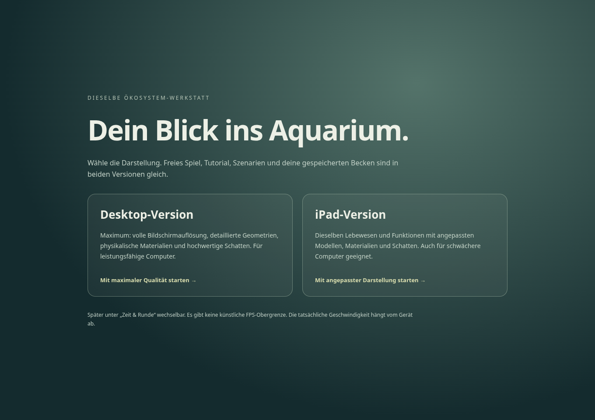
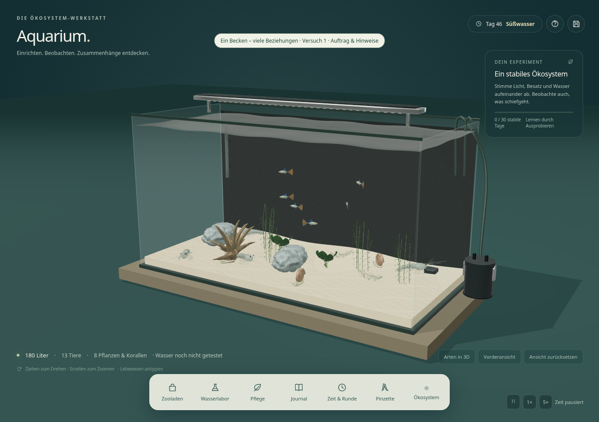
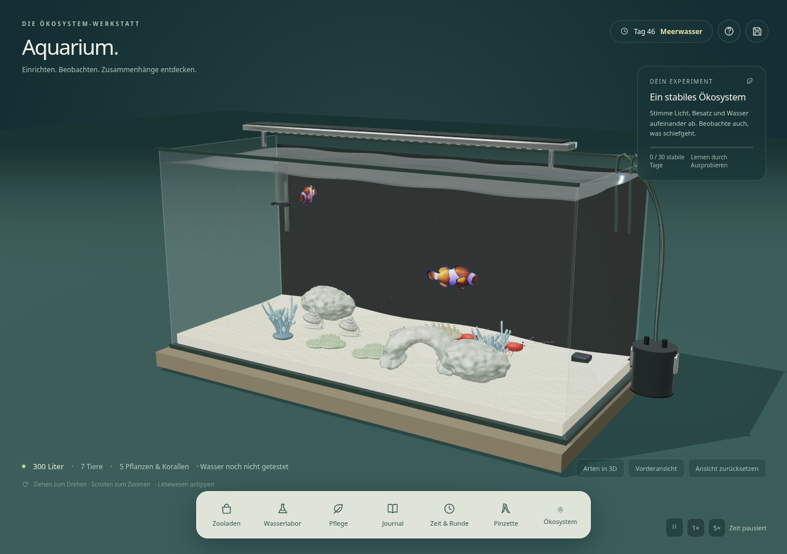
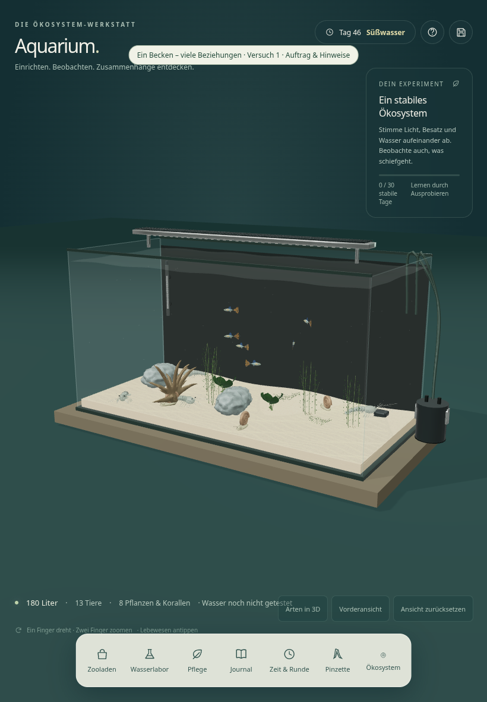
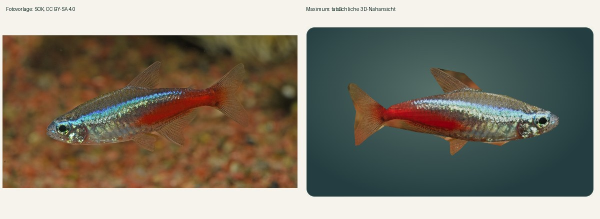

# Grafikprüfung und verbleibende Abnahme

Stand: 19. Oktober 2026. Geprüft wird der Grafikstand `0aace24`; die nachfolgenden Anpassungen betreffen Tests und Dokumentation. Chromium 154, Playwright 1.62, SwiftShader, Node 24.19, Python 3.12.14, Blender 4.3.2. GPU-intensive Läufe erfolgen nacheinander. Keine realen Nutzerspielstände wurden verwendet.

## Gesicherte Ergebnisse

- **39/39 Node-Tests bestanden.** Enthalten sind biologische Regressionen, alte Speicher-/Platzierungsregeln, Katalogdateien und Lizenzen, Standalone-Bündelung, Grafikprofile, alle 22 GLB-Pivots/Bounds/LOD-Verhältnisse, Körperkonturen sowie Körperabstände an Glas/Wasser ohne Schreibzugriff auf Simulationspositionen.
- **181/181 WebP-Vorschauen** aus dem realen Hoch-Modellpfad neu erzeugt, jeweils 384 × 256 Pixel, zusammen 630660 Byte. Alle Kontaktbögen visuell gesichtet.
- **144/144 echte Modellpfade** für Fische, Pflanzen, Wirbellose, Korallen und Dekoration einzeln im iPad-Profil geladen; positive Geometrie und endliche Ausdehnung geprüft. [Messwerte](model-audit-ipad.json).
- Desktop-Auswahl vor allen drei Spielmodi, Maximum-Süßwasser, Ressourcenreduktion bei Profilwechsel und byteidentischer biologischer Speicherstand geprüft. Vier Maximum-Nahansichten aus dem tatsächlichen Modellrenderer aufgenommen.
- Maximum-Meerwasser und iPad-Portrait mit echten emulierten Touch-Ereignissen bestanden; keine JavaScript-/Shaderfehler oder externen Laufzeitabrufe in diesen Abläufen.

Die Grafikprüfung liegt in zwei nachvollziehbaren Läufen vor: [erster Lauf](evidence/graphics-full-attempt.json), [gezielte Meerwasser-/Touch-Nachprüfung](evidence/graphics-marine-touch.json). Der erste Lauf bestand fünf Prüfgruppen und brach danach bei der Erwartung einer kurzlebigen Import-Toastmeldung ab; das Meerwasserbecken war tatsächlich geladen. Der Test wartet jetzt auf den tatsächlichen importierten Zustand. Nur die betroffenen restlichen Prüfgruppen wurden erneut ausgeführt. **Kein vollständig grüner Gesamtlauf des alten Tests wird behauptet.**

Die erneute Funktionsregression nach der Startauswahl ist erfolgreich abgeschlossen:

| Prüfung | Ergebnis | Nachweis |
| --- | --- | --- |
| Maus-/Touch-Pinzette, Kamera, Kollisionen, Abbrechen, Platzierung, alte Saves | 12/12 Prüfgruppen bestanden | [Bericht](evidence/aquascaping.json) |
| Analyse, fünf Szenarien, reale Nahrung/Gesundheit, Tag/Nacht, getrennte Speicherplätze | 12/12 Prüfgruppen bestanden | [Bericht](evidence/ecosystem.json) |
| Start, 3D, Käufe, Wasser/Zeit, Export/Import, Wiederaufnahme, sämtliche acht Tutorialschritte, Touch/Portrait | 13/13 Prüfgruppen bestanden | [Bericht](evidence/readiness.json) |
| Heruntergeladene HTML-Datei allein, neue GLB-Dekoration, Pinzette, keine weiteren Modul-/CSS-/Assetabrufe | bestanden; direkte file:-Navigation gesperrt | [Protokoll](evidence/standalone.txt) |

Die Bereitschaftsprüfung nutzte Hoch für Desktop-Eingaben und iPad für emulierte Touch-Eingaben. Die gesonderten Grafikprüfungen verwendeten die echte vorgeschaltete Auswahl und Maximum. Alle Browserprofile waren isoliert. Die geprüfte Spielquelle blieb während der Bereitschaftsprüfung byteidentisch.

## Darstellung und Ressourcen

Dasselbe tatsächliche Süßwasser-Testbecken mit 24 Lebewesen-/Dekorationsobjekten:

| Messgröße | Desktop Maximum | iPad |
| --- | ---: | ---: |
| Dreiecke laut Renderer | 1699898 | 158118 |
| Drawcalls laut Renderer | 409 | 256 |
| Geschätzte erzeugte Detailtexturen inklusive Mips | 536870916 Byte | 11184816 Byte |
| Geladene Detailmodelle | 24 | 24 |

Die Texturschätzung ist kein vollständiger GPU-Speichermesswert. SwiftShader-FPS sind kein belastbarer Hardwarebenchmark. Die Messung belegt die unterschiedlichen Ressourcenpfade und denselben gespeicherten biologischen Zustand, nicht die Stabilität auf jeder iPad-Generation.

## Tatsächliche Live-Aufnahmen

Die vier Live-Nahansichten verwenden denselben Modelllade-/Materialpfad wie das Aquarium, mit eigener Vorschaukamera: [Neon](screenshots/maximum-closeup-neon.png), [Anubias](screenshots/maximum-closeup-anubias.png), [Amanogarnele](screenshots/maximum-closeup-amanoshrimp.png), [Weichkoralle](screenshots/maximum-closeup-softleather.png). Dies sind keine vorgelagerten Shopfotos.

## Bildkritik und fotografischer Vergleich

Die bereits vorhandenen echten Fotos von Neon, Molly, Clownfisch, Nana und Vallisnerie wurden mit den Modellansichten verglichen. Die fototexturierten Volumenmodelle erhalten mehr reale Farb- und Oberflächendetails als ein rein prozeduraler Ersatz. Sie bleiben deshalb erhalten. Die Gegenüberstellung ist kein unabhängiger Anatomienachweis: Neon verwendet dieselbe Aufnahme als Texturquelle. Quellen und Bedingungen: [Bildnachweis](screenshots/ATTRIBUTION.md).

Die [Fischkontaktübersicht](catalog-fish.jpg) zeigt die Grenze unmittelbar: Betta und die drei fototexturierten Fische wirken deutlich gegenständlicher; die 54 nativen Fische besitzen weiterhin glatte, teilweise schematische Kopf-/Körperformen und synthetische Zeichnung. [Pflanzen](catalog-plants.jpg) brauchen feinere Blattstrukturen und unregelmäßigeren Wuchs. [Wirbellose und Korallen](catalog-invertebrates-corals.jpg) zeigen weiterhin primitive Segmente und wiederholte Polypenformen. [Hardscape](catalog-hardscape.jpg) besitzt jetzt räumliche organische Geometrie, wirkt aber teilweise zu weich und ohne authentische Makrotextur. [Technik und Bedarf](catalog-products.jpg) sind funktional unterscheidbar, jedoch noch vereinfachte Produktdarstellungen.

Auch die vollständigen Becken wirken weiterhin illustrativ. Wasser und Glas sind lesbarer, Licht und Schatten räumlicher; reale spektrale Unterwasserbeleuchtung, komplexe Reflexionen, natürliche Pflanzenmassen und detaillierte Artmodelle fehlen. **Das gewünschte Unreal-/AAA-Vergleichsniveau und eine vollständige Entstilisierung wurden nicht erreicht.** Technische Abdeckung ist kein Ersatz für künstlerische Abnahme. Der [Status jedes Eintrags](CATALOG_STATUS.md) enthält den verbleibenden Bedarf.

## Ausdrückliche Grenzen

Kein echtes Safari/iPad, keine physische GPU-/Speichermessung, keine vollständige visuelle Einzelabnahme aller 181 Einträge unter Maximum und keine unabhängige biologische Vermessung aller Modelle. Die bisherige normalisierte Welt ist nicht über alle Beckengrößen exakt kalibriert. Direkte `file:`-Navigation ist im verwalteten Chromium blockiert; der Standalone-Test muss die unveränderte heruntergeladene HTML-Datei allein über isoliertes HTTP prüfen. Die bekannte automatische Anfrage nach fehlendem `favicon.ico` wird separat erfasst; andere Ressourcenfehler sind nicht ausgenommen.
