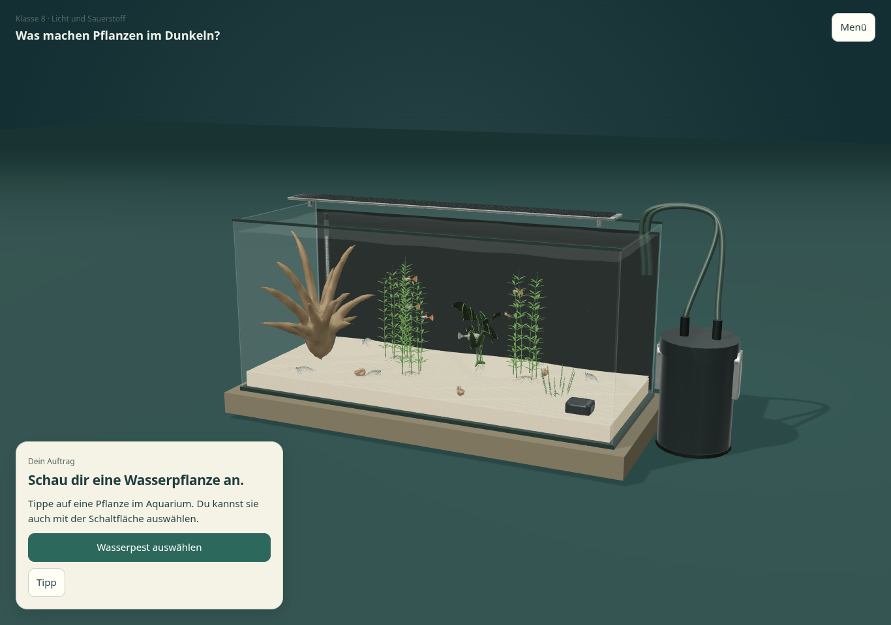
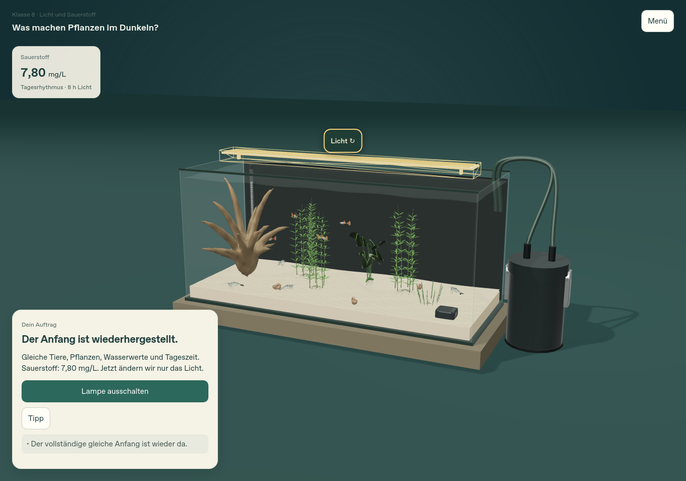
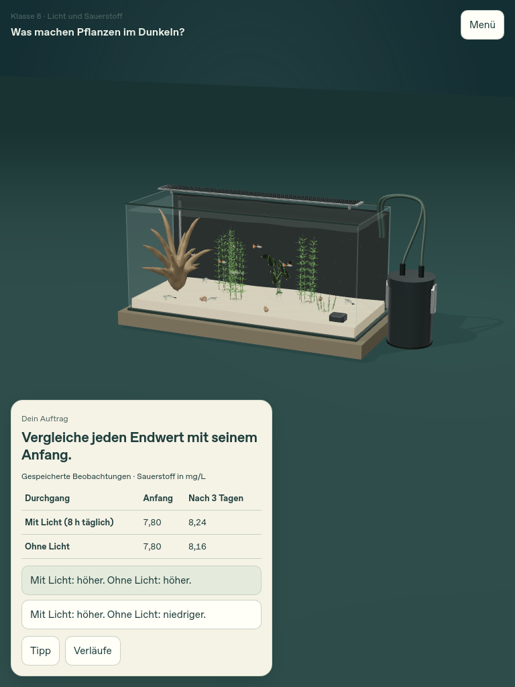
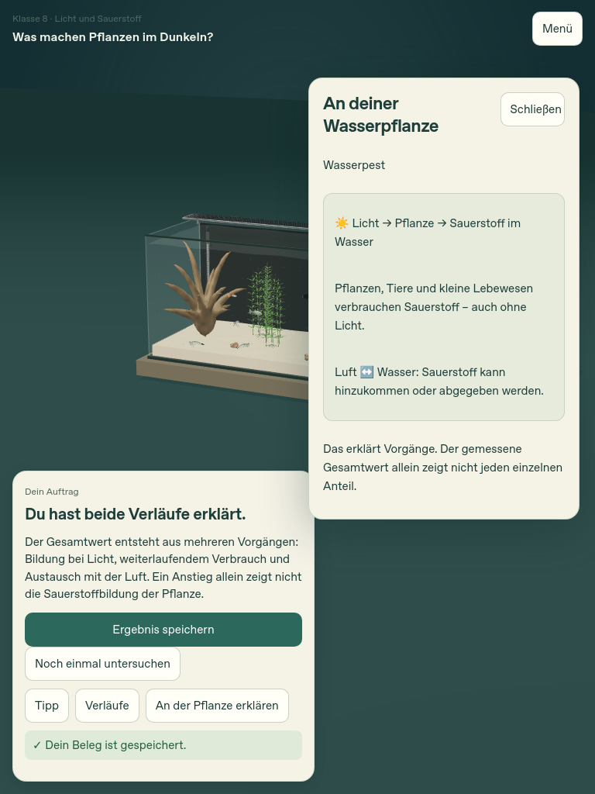
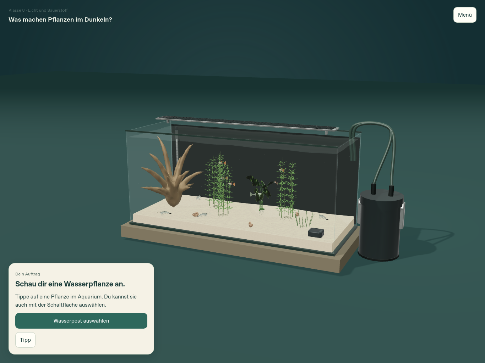

# M1-Prototyp zur neuen Sichtabnahme

**Stand: 22.10.2026, Anwendungscode `260cc516eff7242ff86482b0a086b707d64f3a86`.** [PR #9](https://github.com/Feerson1617/Simulation-Aquarium/pull/9) bleibt Entwurf auf `feature/coherent-learning-workspaces`. [Prototyp öffnen](https://feerson1617.github.io/Simulation-Aquarium/pr-preview/pr-9/). Keine Änderung auf main, kein Merge.

Der [neue Masterauftrag, §15/17](REQUEST.txt) verlangt zuerst einen vollständigen M1-Prototyp und eine **neue ausdrückliche Sichtfreigabe**. Die frühere Freigabe des Temperatur-/Zwei-Becken-Prototyps gilt nicht. M2–M6 und die neue freie Oberfläche sind noch nicht umgesetzt. [Sechs Lernhandlungen, 14 Altzuordnungen und Unterrichtsergänzungen](MISSIONS.md), [64 Bedienentscheidungen und echte Inventare](CONTROL_AUDIT.md).

## Was jetzt spielbar ist

1. M1 beginnen und die Wasserpest im einzigen tatsächlichen Hauptaquarium auswählen. Die beschriftete Alternative wählt ein wirklich vorhandenes Individuum aus; die Szene hebt dieselbe UID hervor.
2. Eine Vermutung neutral speichern. Entwicklung mit acht Stunden Licht täglich ausdrücklich starten, Sauerstoffwert und automatisch aufgenommene kleine Verlaufslinie beobachten. Hilfe, Menü und ausgeblendete Seite halten an. Nach Neuladen bleibt die Entwicklung angehalten.
3. Nach drei Tagen **„Mit gleichem Anfang noch einmal“** wählen. Die vollständige Ausgangslage wird sichtbar wiederhergestellt. Lampe oder direkt benannten Schalter betätigen; nur die Beleuchtung ändern. Nochmals drei Tage beobachten.
4. Echte Anfangs-/Endwerte vergleichen, eine passende Beobachtung und eine biologische Erklärung auswählen. Optional die zwei gespeicherten Kurven oder eine kurze Erklärung an der ausgewählten Pflanze öffnen. Ergebnis speichern; eigene Formulierung freiwillig.

| Sauerstoff im tatsächlichen M1-Modell | Anfang | Nach drei Tagen |
|---|---:|---:|
| Mit Licht, acht Stunden täglich | 7,80 mg/L | 8,24 mg/L |
| Ohne Licht | 7,80 mg/L | 8,16 mg/L |

Beide Werte steigen. Der Beginn liegt bei 06:00 Uhr; deshalb ist der Lichtendwert nicht exakt der in der fremden Gegenprüfung genannten anderen Tagesphase gleich. Originalraten wurden nicht verändert. Die Erklärung unterscheidet lichtabhängige Bildung, weiterlaufenden Verbrauch und Luftaustausch. Der Nettoanstieg allein beweist keine Sauerstoffbildung der Pflanze im Dunkeln.

## Eigene Bilder

Die folgenden Aufnahmen stammen aus den hier verlinkten tatsächlichen neuen Browserläufen, nicht aus der beigefügten Gegenprüfung oder alten 14-Missions-Protokollen. Desktop 1366 × 960, Tablet-Hochformat 768 × 1024, Querformat 1366 × 1024; aktuelle Hauptprüfungen DPR 1. Linux-Softwaregrafik mit ressourcenschonendem iPad-Profil, kein physisches iPad.

Desktop, echter neuer Einstieg (`260cc51`, Chromium):

Desktop, vollständiger Anfang sichtbar wiederhergestellt (`260cc51`, öffentliche Vorschau, WebKit):

Tablet-Hochformat, tatsächlicher Datenvergleich (`260cc51`, WebKit):

Tablet-Hochformat, ausdrücklich geöffnete Erklärung an derselben Pflanze (`260cc51`, WebKit):

Tablet-Querformat (`c6a4383`, WebKit; die folgende Änderung betrifft Hilfetexte, Fokus und kürzeres Fehlerfeedback):

Weitere Aufnahmen: [Portraitstart](evidence/portrait-start-260.png), [Portraitreset](evidence/portrait-restored-260.png), [Desktopvergleich](evidence/desktop-compare-260.png), [Desktoperklärung](evidence/desktop-plant-explanation-260.png), [Querformatvergleich](evidence/landscape-compare-c6.png).

## Eigene Tests mit genauer Versionsgrenze

| Prüfung | Tatsächlich geprüft | Ergebnis und Beleg |
|---|---|---|
| Modultests, `260cc51` | Gesamte vorhandene Suite, davon sechs neue gezielte Einbeckenprüfungen | **179/179**, [Protokoll](evidence/node-260.log). Die 173 bestehenden Kern-/Archivtests sind keine neue 14-Missions-UI-Abnahme. |
| Chromium, `c6a4383` | Vollständiger M1-Weg in Desktop, Tablet hoch und quer; zusätzlicher Speicherfehlerfall | **3 vollständige Profile + 1 Fehlerfall**, [Rohbericht](evidence/main-c6-chromium.json), [Log](evidence/main-c6-chromium.log). |
| WebKit, `c6a4383` | Dieselben drei vollständigen Profile und Speicherfehlerfall | **3 vollständige Profile + 1 Fehlerfall**, [Rohbericht](evidence/main-c6-webkit.json), [Log](evidence/main-c6-webkit.log). |
| Letzte Hilfe-/Fokusänderung, `260cc51` | Gezielte vollständige Wege: Chromium Desktop, WebKit Hochformat; aufgabenweise Hilfestufen, echter Tab/Enter-Weg, zusätzliche Geometrie pro Schritt, nochmals Speicherfehler | **Je 1 vollständiges Profil + 1 Fehlerfall**, [Chromium](evidence/delta-260-chromium.json), [WebKit](evidence/delta-260-webkit.json). Die unveränderten Querformatwege wurden nicht grundlos nochmals vollständig gerechnet. |
| Erhaltener Expertenbereich, `ff96365` | Freies 120-L-Becken platzieren, Katalog, Tier/Pflanze einsetzen, Modelle, Wasser/Zeit, Export/Reload/Import in frischem Profil, alle acht tatsächlichen Tutorialschritte, Portrait/Menü | **13/13**, [Rohbericht](evidence/expert-ff96365.json), [Log](evidence/expert-ff96365.log). Spätere Änderungen betreffen nur das neue M1-Modul und dessen CSS; Expertenkern/Route unverändert. |
| Alter Ausgangsbildschirm, `4e59de3` | Getrennte Wiedergabe der drei tatsächlich geöffneten alten Oberflächen, unveränderter Assetbestand | **3 Inventare**, [Rohbericht](evidence/baseline-4e-controls.json). Keine erfundene alte Browserabnahme. |
| Öffentliche PR-Vorschau, `260cc51` | Verifizierte HTTPS-Abrufe aller 61 Root-Laufzeit-/Archivbibliotheksdateien; zusätzlich echter WebKit-Desktopweg mit Dateiimport/-export und Speicherfehler | **61/61 Hashes identisch**, [Quellbeleg](evidence/preview-sources-260.json); **1 vollständiges Profil + 1 Fehlerfall**, [Browserbericht](evidence/public-260-webkit.json), [Log](evidence/public-260-webkit.log). Keine TLS-Ausnahme. |
| Einzel-HTML, `260cc51` | Wirklich gebündelte Datei in Chromium und WebKit über lokalen HTTP-Unterpfad geladen, danach Netzwerk abgeschaltet; vollständiges M1 und Dateiresultat | **Je 5 Prüfungen**, [Chromium](evidence/standalone-260-chromium.json), [WebKit](evidence/standalone-260-webkit.json), [Artefaktgröße und SHA-256](evidence/standalone-artifact-260.json). Nur der initiale Dokumentabruf, keine nachgeladenen HTTP-Ressourcen. Kein Nachweis für natives `file:`-Starten. |
| Bestandsschutz im Quelltext, `260cc51` gegen `4e59de3` | Acorn-Vergleich sämtlicher oberster Funktionen/Klassen, gesonderte Kern-/Lader-/Rendererkennungen, Assets, Genetik, AGENTS und Workflows | **Keine Änderungen an diesen Deklarationen/geschützten Dateien**, [Quellvergleich](evidence/source-audit-260.json). Der Host erhält nur den expliziten geprüften Snapshot-Öffnungsweg; kein neuer biologischer Rechenkern. |

Die vollständigen M1-Wege werden durch sichtbare Aktionen verdient, ohne Questzustände zum Bestehen zu setzen. Snapshots ergänzen die Bildbelege: Rendererzustand und Hauptzustand sind identisch; UID-Mengen, Sauerstoffwert, Kurve, Zeitpunkt und Export stimmen überein. Ein Testprobe-Aufruf am Ende rechnet eine Kopie unabhängig nach; im Spiel läuft kein zweites Becken. Die Touchprofile betätigen den tatsächlichen Lampenanker. Pflanzen wurden in den dokumentierten Läufen über die sichtbare benannte Alternative gewählt; ein erfolgreicher direkter Canvas-Pflanzentreffer wird nicht behauptet.

Jedes vollständige Profil enthält eine plausible falsche Beobachtung, Hilfe, Korrektur, eine plausible falsche Prozesserklärung, Korrektur, Reload, archivierte Wiederholung und tatsächlichen Dateiimport. Der alte Fixture-Speicher bleibt bytegleich. Start-/Resetzustände und alte Laufdaten werden vollständig verglichen; je Durchgang sind es 13 tatsächliche Vierteltagespunkte einschließlich Anfang. Ein fehlgeschlagener Lauf stoppt ohne erfundene Folgemessung. Validierung weist widersprüchliche Messungen/Archive und Kontextkennungen zurück.

Beispielprodukte aus echten Bedienwegen: [Desktop](evidence/desktop-result-260.json), [Hochformat](evidence/portrait-result-260.json). Sie unterscheiden Vermutung/Auswahl, Handlung, Simulationswerte, vorgegebene Erklärung und fehlenden/eigenen Text. **Kein automatisch erzeugter eigener Hypothesentext und kein behaupteter Lernzuwachs.** Der getrennte Quotenfehler hält an, lässt die letzte erfolgreiche lokale Sicherung unangetastet und erlaubt [Dateirettung](evidence/storage-rescue-260.json).

## Gefundene Fehler und Korrekturen

- Ein alter globaler Quiz-Handler reagierte zunächst auf neue Antwortbuttons. Eigene `data-single-choice`-Attribute und abgegrenzte Ereignisse beseitigen die beiden Nullzugriffe; die abschließenden Browserberichte haben keine Seitenfehler oder fehlgeschlagenen Requests.
- Vollständiger DOM-Neubau bei jedem Messpunkt konnte die laufende Bedienung unterbrechen. Während Beobachtungen wird jetzt nur die Messkarte aktualisiert; Pause/Hilfe bleiben stabil.
- Der erste Portraitvergleich ließ mit Fehlerfeedback nur 68,42 % frei ([fehlgeschlagener Entwicklungsbericht](evidence/development-portrait-failure.json)). Kompakte Footer, zwei sinnvolle Beobachtungsalternativen, kürzere Rückmeldung und Kameraausschnitt lösen dies. Die letzte Hilfeänderung beginnt zudem pro Aufgabe neu und erhält den Tastaturfokus.
- Ein verstecktes Dateifeld wurde durch alte generische Eingabestile sichtbar. Explizite Hidden-Regel; sämtliche normalen M1-Inventare ohne sichtbares Eingabefeld.

Diese fehlgeschlagenen Entwicklungsstände werden nicht als bestandene Endläufe gezählt.

## Grenzen und nächster Schritt

Kein physisches iPad/Safari, keine Messung realer GPU-/Speicherauslastung und keine Unterrichtserprobung. Die bestehende Grafik ist erkennbar vereinfacht; es wurden keine neuen fotorealistischen Modelle behauptet. Die Einzel-HTML ist etwa 151 MB groß. Ihr bereits geladenes Offlineverhalten belegt weder frisches natives Dateiöffnen noch praktikable iPad-Ladezeiten. Das große Artefakt bleibt außerhalb Git; Größe und Hash sind belegt.

M3/M4 besitzen noch keine neue Identitätsbrücke; ihre Entwicklung ist ein eigener früher Risikopunkt nach der Freigabe. M2/M5/M6, freie Werkzeuggruppen, abschließende Altimport-/Lehrkraftkonfiguration und unabhängige Quellen-Endprüfung bleiben offen. Die fachlichen Entwürfe ersetzen nicht das gesamte ETS-Curriculum.

**Jetzt den M1-Prototyp ansehen und ausdrücklich freigeben oder konkrete Änderungswünsche nennen.** Bis dahin keine flächendeckende Umsetzung von Phase 3/4 und kein Merge. [Wiederaufnahmestand](WORK_STATE.md). [Manifest](evidence/MANIFEST.json) ordnet die neuen Belege ihren Quellen zu; historische Unterlagen in `docs/coherent-learning` bleiben erhalten.
