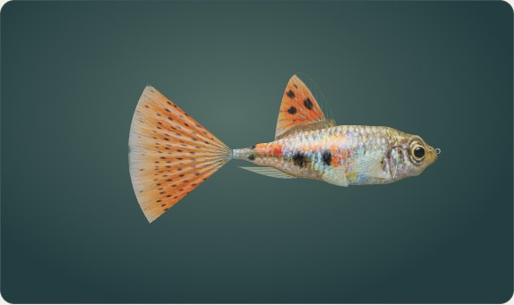
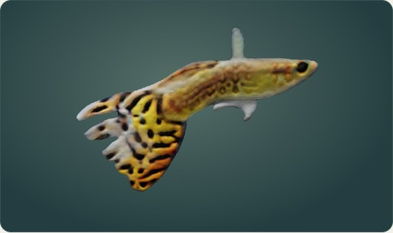
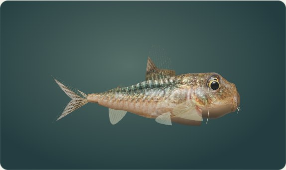
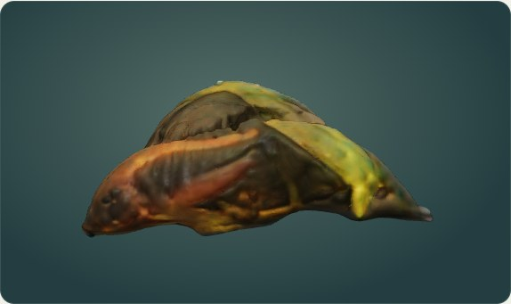
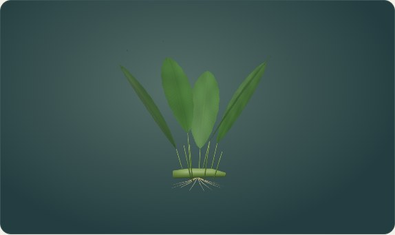
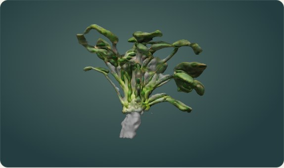
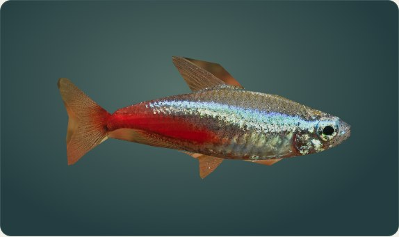
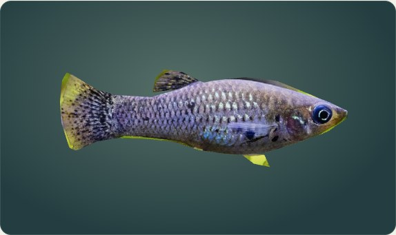

# Fotobasierter Modellversuch: keine Übernahme

**Abnahme am 20. Oktober 2026: 0 von 3 Pilotarten übernommen.** Die CPU-Rekonstruktion funktioniert technisch. Der sichtbare anatomische Qualitätsgewinn reicht jedoch bei keinem Piloten für den Austausch der Spielmodelle. Das Verfahren wird deshalb nicht auf weitere Arten ausgeweitet. Es wurden keine weiteren vereinfachten Serienmodelle erzeugt.

## Tatsächliche Browservergleiche

Die Bilder zeigen die bestehende Artgalerie des Spiels bei Ultra, jeweils mit derselben Beleuchtung und demselben Browserformat. „Grundansicht“ ist die anfängliche Galerieansicht; Schrägansicht und Rückseite entstehen durch tatsächliches Drehen mit der Maus.

| Art | Bestehendes Modell | Fotobasierter Versuch | Befund / weitere Ansichten |
| --- | --- | --- | --- |
| Guppy |  |  | Dicke, unregelmäßige Flossen und verformte Schwanzkontur. [Schräg](comparison/trial-guppy-oblique.jpg), [Rückseite](comparison/trial-guppy-rear.jpg). **Abgelehnt.** |
| Metallpanzerwels |  |  | Körper und Flossen verschmelzen; Barteln und Panzeranatomie sind nicht aufgelöst. [Schräg](comparison/trial-cory-oblique.jpg), [Rückseite](comparison/trial-cory-rear.jpg). **Abgelehnt.** |
| Anubias, korrigiertes Einzelpflanzenfoto |  |  | Mehr Oberflächendetail, aber dicke, teils verschmolzene Blätter/Stängel und eine graue Wurzelmasse. [Schräg](comparison/isolated-anubias-oblique.jpg), [Rückseite](comparison/isolated-anubias-rear.jpg). **Abgelehnt.** |

Der ursprüngliche Anubias-Versuch hatte aus einer Aufnahme eines dichten Pflanzenbestands vor allem das weiße Beschriftungsschild freigestellt. [Dieses Fehlerbild](comparison/trial-anubias-front.jpg) ist dokumentiert, wurde aber nicht als endgültiger Pflanzentest gewertet. Der gezielte zweite Versuch verwendet stattdessen [eine fotografierte einzelne Pflanze mit sichtbaren Wurzeln](comparison/reference-anubias-isolated.jpg), inferiert erneut auf CPU (120,23 Sekunden) und bleibt aus mehreren Blickwinkeln anatomisch unzureichend.

Die korrigierte Pflanze wurde außerdem tatsächlich im Aquarium über den bestehenden Modelllader eingesetzt: [Frontansicht](comparison/isolated-anubias-aquarium-front.jpg), [Schrägansicht](comparison/isolated-anubias-aquarium-oblique.jpg). Die drei Pilotarten sind in den jeweiligen Laufartefakten auch als echte normalisierte GLBs vorhanden. Ein bloßes Anzeigen des Ausgangsfotos wurde nicht als 3D-Modell ausgegeben.

Als positive Bestandsreferenzen wurden auch Neonsalmler und Molly unter denselben Galeriebedingungen aufgenommen:

| Neonsalmler | Molly |
| --- | --- |
|  |  |

Die Bestandsmodelle besitzen ebenfalls Vereinfachungen. Im Vergleich sind ihre Konturen und fotografischen Oberflächendetails jedoch konsistenter als die gezeigten Rekonstruktionen. Ein höherer Polygonwert oder eine nominell große Textur ist keine Qualitätsabnahme.

| Pilot | Dreiecke des Versuchs | Gebackene Textur | Entscheidung |
| --- | ---: | --- | --- |
| Guppy | 41.396 | 2048 × 2048 | Keine Übernahme |
| Metallpanzerwels | 85.960 | 2048 × 2048 | Keine Übernahme |
| Anubias, korrigiert | 130.728 | 2048 × 2048 | Keine Übernahme |

Hinzu kommt bei den rekonstruierten Fischen das einzelne Oberflächenmesh ohne die bisherigen semantischen Flossen-/Geschlechtsstrukturen. Eine Produktionsübernahme müsste auch Farbvarianten, Animation, mobile Detailstufen und Genetikdarstellung erneut absichern. Die sichtbaren Formfehler verhindern die Übernahme bereits vorher.

## Nachweise und Modelldateien

- [Abnahmeentscheidung](quality-decision.json), [erste drei Piloten und Bestandsmessungen](runtime-review.json), [korrigierte Pflanze im Spiel](plant-runtime-review.json), [Foto-/Erzeugungsbeleg](plant-generation.json).
- [Erster vollständiger Browservergleich](https://github.com/Feerson1617/Simulation-Aquarium/actions/runs/39272907955).
- [Korrigierter Pflanzenlauf](https://github.com/Feerson1617/Simulation-Aquarium/actions/runs/39352881052) und [Artefakt mit Roh-OBJ, Texturen und drei normalisierten GLBs](https://github.com/Feerson1617/Simulation-Aquarium/actions/runs/39352881052/artifacts/12233599665), Aufbewahrung 30 Tage. Die verworfenen Versuchs-GLBs sind nicht Teil der ausgelieferten Spielassets; Bilder und Belege bleiben dauerhaft im Branch.
- [UI vorher](comparison/before-object-guppy.png), [UI nachher](comparison/after-object-guppy.png), [vollständiger Funktions-/Testbericht](../UI_MODEL_REVIEW.md).

## Geprüftes Verfahren

[Offizielles TripoSR](https://github.com/VAST-AI-Research/TripoSR/tree/107cefdc244c39106fa830359024f6a2f1c78871), Code/Modell unter MIT, festgelegter Quellcommit. Ausführung mit PyTorch 2.5.1 CPU, vier CPU-Threads, `--device cpu --chunk-size 1024 --mc-resolution 256 --bake-texture --texture-resolution 2048`. Die öffentlichen Gewichte und lizenzierten Fotos wurden ohne Anmeldung heruntergeladen. Es gab keine CUDA-GPU und keine bezahlte API. Die CPU-Berechnung hat tatsächlich funktioniert; fehlendes CUDA ist deshalb **nicht** die Ursache der abgelehnten Bildqualität.

Die Rekonstruktionen sind aus einem Foto inferierte Oberflächen mit gebackenen Texturen, keine vermessenen Mehransicht-Scans. Nach dem OBJ-Export wurden UVs und eingebettete Texturen in selbstständige GLBs übernommen. Die TripoSR-Achsen `x-back/y-right/z-up` wurden in die Spielachsen transformiert, Fischlänge bzw. Pflanzenhöhe an die bestehenden Artmodelle angepasst und alle Puffer/Bilder auf lokale Einbettung geprüft. Quantisierte Bestands-GLBs wurden dabei einschließlich normalisierter Integer-Accessorwerte und Knotentransformationen vermessen.

Für die Abnahme wurden keine alten, falsch skalierten Vorversuche verwendet. Verglichen wurde im echten Spiel bei **Ultra**, Desktop-GLBs, gleicher Galeriebeleuchtung und mehreren per Maus gedrehten Blickwinkeln. Die Versuchskopie lud die Piloten über die unveränderten Art-GLB-Pfade; anschließend stellte das Skript die ursprünglichen Assetbytes im `finally`-Block wieder her. Zusätzlich wurden die Piloten im Aquarium aus Front-/Schrägansicht aufgenommen. Diese Bilder stammen aus Chromium/WebGL mit Software-Rasterisierung; keine KI-generierten Vergleichsscreenshots.

## Andere kostenlose Wege

| Weg | Prüfung und Folgerung |
| --- | --- |
| Hunyuan3D 2.1 | Das [offizielle README](https://github.com/Tencent-Hunyuan/Hunyuan3D-2.1) nennt 10 GB VRAM für Form, 21 GB für Textur und 29 GB zusammen. Hier steht keine CUDA-GPU bereit. Die [konkret geprüfte 2.1-Lizenz](https://github.com/Tencent-Hunyuan/Hunyuan3D-2.1/blob/main/LICENSE) schließt außerdem EU, UK und Südkorea aus. Diese Version wurde nicht ausgeführt oder eingebunden. Das ist keine Aussage über sämtliche Hunyuan-Versionen. |
| [COLMAP](https://colmap.github.io/) / [OpenMVS](https://github.com/cdcseacave/openMVS) | Kostenlose Mehransicht-Rekonstruktion ist eine mögliche Alternative, benötigt aber überlappende Ansichten desselben hinreichend starren Motivs. Solche Datensätze liegen für die Pilotarten nicht vor. Schwimmbewegung, Pflanzenbewegung, Glasspiegelungen und transparente Flossen erschweren die Aufnahme. Keine Ausführung oder Qualitätsabnahme behauptet. |
| [Blender](https://www.blender.org/) mit Fotoprojektion/Retopologie | Dauerhaft kostenlos, ohne Konto und auf CPU nutzbar. Für ein belastbares Ergebnis sind anatomische Modellierung, getrennte dünne Flossen/Blätter und gezielte Fototexturierung nötig. Diese manuelle Arbeit wurde hier nicht durch weitere primitive Serienmodelle ersetzt und nicht als erledigt ausgegeben. |

Die Versuche belegen die Grenzen **dieser automatischen Einzelbildmethode und der verfügbaren Eingaben**, keine prinzipielle Unmöglichkeit hochwertiger kostenloser Modelle. Eine Ausweitung auf weitere Arten ist ohne bestandene Einzelabnahme nicht begründet.

## Wiederholen

Die temporären Actions-Prüfworkflows werden nach Abschluss entfernt. Die Skripte bleiben im Repository:

```bash
# Unter Linux mit Python, Git, C++-Buildwerkzeugen, xvfb und Mesa:
python tools/realism/triposr_feasibility.py
python -m pip install playwright==1.56.0
python -m playwright install --with-deps chromium
python tools/realism/review_triposr_candidates.py > /tmp/aquarium-model-review.log
```

Das erste Skript installiert die festgelegten freien Python-Abhängigkeiten und lädt öffentliche Modelldaten/Fotos; es benötigt entsprechend Arbeitsspeicher und Plattenplatz. Das zweite Skript legt Screenshots, Berichte und normalisierte Versuchs-GLBs unter `docs/ui-model-review/feasibility/` ab. Die Produktionsdateien werden nur für die lokale Prüfung überlagert und wiederhergestellt. Die vorhandenen Spielstände werden dabei nicht verwendet.

Die Ergebnisse mit Roh-OBJ, Texturen und drei normalisierten GLBs liegen zusätzlich im verlinkten Actions-Artefakt (zeitlich begrenzte Aufbewahrung); die ausgewählten Vergleichsbilder und Berichte in diesem Ordner bleiben im Git-Branch erhalten.


## Rechte der Vergleichsbilder

- Neue Guppy-Rekonstruktion: Foto von Benoît Prieur, Farbanpassung Togabi, [CC0](https://creativecommons.org/publicdomain/zero/1.0/), [Quelle](https://commons.wikimedia.org/wiki/File:Poecilia_reticulata_(male).JPG). Änderungen: automatische Freistellung, 3D-Rekonstruktion, Texturbacken, Browseraufnahme.
- Neue Corydoras-aeneus-Rekonstruktion: Jofre, vom Urheber gemeinfrei gestellt, [Quelle](https://commons.wikimedia.org/wiki/File:Corydoras_aeneus_1.0.JPG). Gleiche Bearbeitungsschritte.
- Erster Anubias-Versuch: Daderot, CC0, [Quelle](https://commons.wikimedia.org/wiki/File:Anubias_barteri_var._nana_-_Botanischer_Garten_-_Heidelberg,_Germany_-_DSC01278.jpg). Gleiche Bearbeitungsschritte; misslungene Motivfreistellung.
- `existing-neon-*.jpg`: bearbeitete Darstellung auf Basis des Fotos von SOK, [Quelle](https://commons.wikimedia.org/wiki/File:Paracheirodon_innesi_neon_tetra.jpg), [CC BY-SA 4.0](https://creativecommons.org/licenses/by-sa/4.0/). Dieses abgeleitete Bild steht ebenfalls unter CC BY-SA 4.0. Änderungen: Textur-/Volumenmodell, Licht und Browseraufnahme.
- `existing-molly-*.jpg`: bearbeitete Darstellung auf Basis des Fotos von Dnoerholm, [Quelle](https://commons.wikimedia.org/wiki/File:PoeciliaSphenops.jpg), [CC BY-SA 4.0](https://creativecommons.org/licenses/by-sa/4.0/). Dieses abgeleitete Bild steht ebenfalls unter CC BY-SA 4.0. Gleiche Änderungen.
- Bestehender Guppy und Panzerwels: eigene Projektgrafik; siehe `assets/species/ATTRIBUTION.md` (erzeugte Vorlage gemäß OpenAI-Nutzungsbedingungen). Bestehende Anubias: eigene prozedurale Projektgrafik, CC0. Alle Vorschaubilder zeigen Modelle und sind keine verifizierten Tierfotografien.

- Korrigierter Anubias-Versuch (`isolated-anubias-*.jpg`, einschließlich Aquariumaufnahmen), `reference-anubias-isolated.jpg` und die zugehörigen Anubias-Modell-/Texturdateien im letzten Artefakt: Abhik.Mazumdar.73, [Originalfoto](https://commons.wikimedia.org/wiki/File:Anubias_barteri_var._nana.jpg), [CC BY 4.0](https://creativecommons.org/licenses/by/4.0/). Änderungen: JPEG-Verkleinerung für die Referenz; automatische Freistellung, 3D-Rekonstruktion, UV-/Texturbacken, Maßstab/Achsenausrichtung und Browseraufnahmen für die Ableitungen. Die Ableitungen werden ebenfalls unter CC BY 4.0 bereitgestellt. Referenzvarietät ist *nana*; es wird keine Übereinstimmung mit einer anderen Varietät behauptet.

Die genannten Bildlizenzen gelten für die jeweiligen Bilder und Ausgangsquellen, nicht pauschal für den Programmcode.
